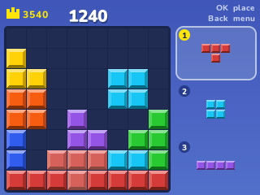

# Block Blast

Fit the blocks on the 8×8 board; fill a row or a column and it blasts away. Hungry Studio's puzzle for the NumWorks calculator, playing and looking like the phone game.

- **Three blocks at a time**, placed in any order. None of them turns, and new ones come when all three are down.
- **The game's 41 blocks**: lines of 1 to 5, squares, rectangles, corners, L, T, S and Z shapes and diagonals, each one coming as often as it does in the app.
- **Scoring like the original**: a point for each square placed, 10 for a line, 20, 60, 120... for two, three, four lines at once, times your combo. Clear again within three blocks to keep the combo going, and empty the whole board for 300 more.
- **Good!, Great!, Excellent!, Amazing!, Unbelievable!** for big clears, and your combo counted on screen.
- The rows and columns a block would fill light up in its colour before you place it, and blocks that can't go anywhere turn grey in the tray.
- The game ends when none of your blocks fits. Your game and best score are saved, so you can stop and carry on later.

## Controls

| Key | Action |
| --- | --- |
| 1, 2, 3 | Take that block |
| Arrows | Move it on the board |
| OK or EXE | Place it |
| Back | Menu: Resume, New game, How to play, Quit |

## Credits

Block Blast! is **[Hungry Studio](https://www.hungrystudio.com)**'s game (2022). This version is written in C for NumPlay, with no code or art from the original: its blocks, scoring and colours follow what players have measured from the app.

Inside NumPlay it draws with the launcher's own shapes and fonts and saves through its file functions, so the game itself is about 5 KB.

It comes inside [NumPlay](https://github.com/thatbignguy/NumPlay), or on its own as `BlockBlast.nwa` from the [latest release](https://github.com/thatbignguy/NumPlay/releases/latest).

Build: `make` (needs `arm-none-eabi-gcc` and Node.js for nwlink).
