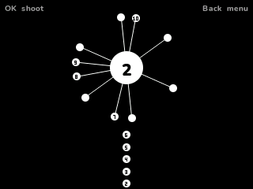

# Core Ball

Shoot every ball into the spinning core without touching the ones already on it. Random's Core Ball for the NumWorks calculator, ported from its source.

- **One button.** Press OK to shoot the next ball up into the core. Hit a ball that's already there and you miss.
- **The original's 60 levels.** The same balls on the core, the same number to shoot, and the same turns: steady, faster, back and forth, speeding up and slowing down, and turning back each time you shoot.
- **Exact timing.** The core turns frame by frame as in the original, and a ball misses exactly where it would there.
- **The original's look.** White balls on black, the green clear with the balls flying off, the red miss, the gray start screen and its sliding panels. After level 60, "to be continued...".
- **Any level you've reached**, from the menu's level list.
- Your level is saved, so you can stop and carry on later.

## Controls

| Key | Action |
| --- | --- |
| OK or EXE | Shoot a ball |
| Back | Menu: Resume, Restart, Levels, How to play, Quit |

## Credits

Core Ball is **[Random](https://github.com/randomyang/core-ball)**'s (Yang Hao's) game (2015, MIT License). Not affiliated with its maker. **Bobydeluxe** brought it to the calculator. This version is written in C from its source: its levels, turns, speeds, timings and colours are the original's (see [LICENSES/MIT-CoreBall.txt](../../LICENSES/MIT-CoreBall.txt)).

Inside NumPlay it draws with the launcher's own shapes and fonts and saves through its file functions, so the game itself is about 5 KB.

It comes inside [NumPlay](https://github.com/Mason363/NumPlay), or on its own as `CoreBall.nwa` from the [latest release](https://github.com/Mason363/NumPlay/releases/latest).

Build: `make` (needs `arm-none-eabi-gcc` and Node.js for nwlink). Tests: `make test`.
