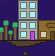
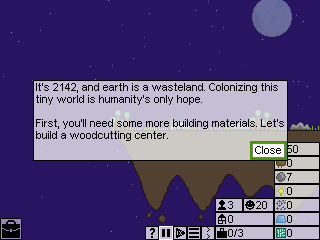
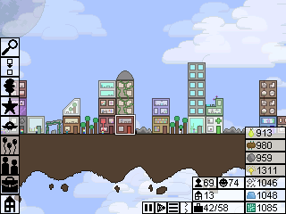
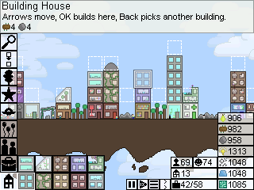
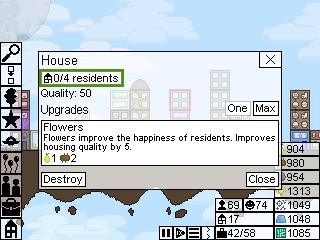
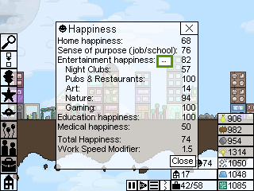
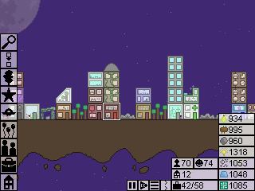
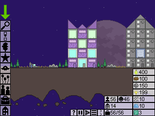
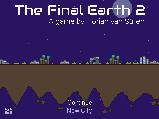

> **The Final Earth 2 is a [NumPlay](../../README.md) game that comes on its own.** It is too big to fit next to NumPlay on the calculator. Get `FinalEarth2.nwa` from the [latest release](https://github.com/Mason363/NumPlay/releases/latest).

  

<h1 align="center">The Final Earth 2</h1>

  <b>Build a city on floating islands in space, on the NumWorks calculator.</b> 
  All four scenarios and the six free play maps of the free version.

  <a href="https://github.com/Mason363/NumPlay/releases/latest/download/FinalEarth2.nwa"><b>Download FinalEarth2.nwa</b></a>
  &nbsp;·&nbsp; <a href="#controls">Controls</a>

  

## Highlights

* **Every scenario:** A New Beginning, An Interworld City, Hacking Alien Tech and City of the Key, with their goals, stories and tutorials.
* **Free play:** Mega World, Random Archipelago, Empty Canvas, Divided, Random Mini Worlds and Many Worlds, with the starting resources and citizens you choose.
* **Every building:** 87 of them, from houses, farms and woodcutters to labs, factories, teleporters, parks, restaurants and the alien buildings, each with its upgrades.
* **Citizens live their lives:** they walk to work and to school, eat, look for fun after work, have children, grow old, and pick up hobbies.
* **Research, upgrades and policies:** the same costs and effects as the original, down to the numbers.
* **The game's look:** its own pictures, fonts, sky, planets, clouds and floating islands, day and night.
* **Saved as you go:** Home saves and quits, the game saves every other day, and Continue picks up where you left off. Your city is also copied into `finalearth2_saves.py`, so installing the app again doesn't erase it.

<table>
  <tr>
    <td align="center"> A New Beginning: the first scenario</td>
    <td align="center"> A city on Mega World, in free play</td>
  </tr>
  <tr>
    <td align="center"> Building: the places a house can go are outlined</td>
    <td align="center"> A house's window, with its upgrade</td>
  </tr>
  <tr>
    <td align="center"> What makes your citizens happy</td>
    <td align="center"> The same city at night</td>
  </tr>
  <tr>
    <td align="center"> City of the Key</td>
    <td align="center"> The title screen</td>
  </tr>
</table>

## How to play

Choose a scenario, or a free play map. Your citizens need homes, food and work: build woodcutters and stone mines for materials, farms for food, and houses to live in. Buildings stack on top of each other, so your city grows up as well as out. In a scenario, each goal tells you what to do next, and **?** at the bottom right shows the current one again.

Move the cursor with the arrows. Press **toolbox** to open the build menu: left and right go through the buildings, up and down change the category, and **OK** picks one. Then move to where you want it and press **OK** to build; **Back** goes back to the menu to pick another. Press **OK** on a building to see what it does, upgrade it, or see who lives and works there. Press **var** to reach the buttons and materials at the bottom right: population, happiness, speed, pause and the menu.

## Controls

| Key | What it does |
| --- | --- |
| Arrows | Move the cursor, or the focus in menus and windows |
| shift + arrows | Move the view faster |
| OK | Open what is under the cursor, choose, build here |
| Back | Close, stop building, open the game menu |
| toolbox | Open or close the build menu |
| var | Go to the buttons and materials at the bottom right, and back |
| alpha | Pause |
| + and - | Zoom in and out |
| ⌫ | Destroy the building under the cursor |
| Home | Save and quit |

On the speed button, **OK** switches between normal and double speed, and **shift** with **OK** goes through all five speeds. While building, hold **OK** and move to build on every cell you pass, in the building modes that allow it. When the game asks for a name, type it with **alpha** (twice to keep letters on), or pick letters from the grid on screen.

## Good to know

* **On its own:** The Final Earth 2 is too big to fit next to NumPlay. Installing it from the NumWorks website swaps out NumPlay and the other apps, and installing NumPlay again swaps it back out. Your city in each one is kept.
* **The free version's content:** the premium and holiday buildings and scenarios are not here, and there is no music or sound (the calculator has no speaker).
* **A few limits:** a city holds up to 800 citizens and 700 buildings, and Random Mini Worlds makes 63 worlds instead of 400, so they fit in the calculator's memory.
* **No ads:** the original's production boost from watching an ad is left out.

## Credits

Inspired by [The Final Earth 2](https://store.steampowered.com/app/1180130/The_Final_Earth_2/) by [Florian van Strien](https://florianvanstrien.nl), not affiliated with him. Go play the original: it's on Steam, Android, iOS and the web, with music, the premium scenarios and more.

* The pictures, fonts, texts and citizens' names come from the game's own files, and its rules, numbers and the way citizens find their way follow the game's own code.
* Additional sprites by LukXD99, as in the original's credits.

Made by Mason Chen as part of NumPlay.

## License

The game's code is licensed under the GNU General Public License v3.0: see the `LICENSE` file at the root of the repository. The game's pictures, fonts and texts keep their own terms (see Credits).
