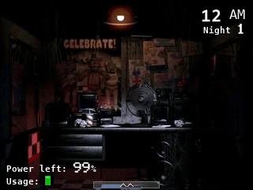
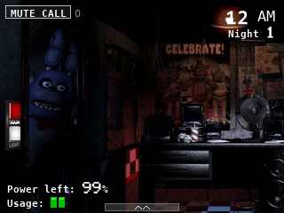
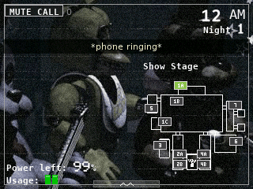
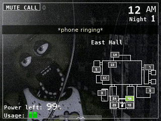
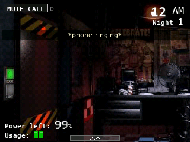
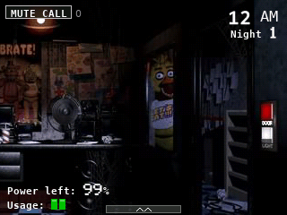
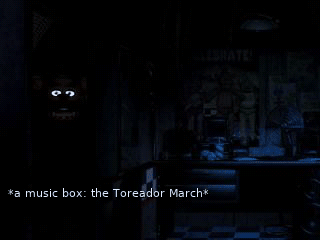
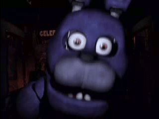
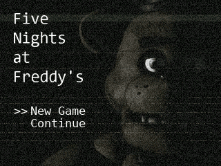
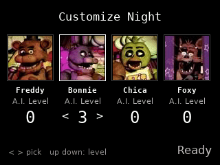

> **Five Nights at Freddy's is a [NumPlay](../../README.md) game that comes on its own.** It is too big to sit next to NumPlay. Get `FiveNightsAtFreddys.nwa` from the [latest release](https://github.com/Mason363/NumPlay/releases/latest).

  

<h1 align="center">Five Nights at Freddy's</h1>

  <b>Survive the night shift at Freddy Fazbear's Pizza, on the NumWorks calculator.</b> 
  All five nights, the 6th and the Custom Night, with the game's own pictures.

  <a href="https://github.com/Mason363/NumPlay/releases/latest/download/FiveNightsAtFreddys.nwa"><b>Download FiveNightsAtFreddys.nwa</b></a>
  &nbsp;·&nbsp; <a href="#controls">Controls</a>

## Highlights

* **The whole game:** nights 1 to 5, the 6th night once the 5th is beaten, then the Custom Night with its four AI levels and the 4/20 mode. The paycheck, the overtime and the pink slip, and the three stars on the title screen.
* **The office as you know it:** turn left and right, close the doors, light the doorways to see who is standing there. The buttons light up, the fan turns, the lights flicker.
* **The monitor and its eleven cameras:** the Show Stage, the Dining Area, Pirate Cove, the West and East Halls and their corners, the Supply Closet, Backstage, the Restrooms and the Kitchen (audio only), on the map, each slowly turning with its static. Cameras cut out when someone moves on the one you watch.
* **Freddy, Bonnie, Chica and Foxy as the game moves them:** their AI levels for each night and their rises at 2, 3 and 4 AM, a movement opportunity every 3.02, 4.97, 4.98 and 5.01 seconds, their paths through the building. Freddy only moves while the monitor is down (but for his last step), Foxy comes out when the cameras stay down and runs down the West Hall, bangs on a closed door and takes your power.
* **The power:** a point a second for each bar of usage, a little more each night, Foxy's bangs. When it runs out the doors open, Freddy's face lights up at the left door to the Toreador March, then the dark.
* **The Phone Guy's calls as subtitles,** each line when it is said, and what can be heard as captions: footsteps, Freddy's laugh, pots and pans in the kitchen, the music box, Foxy's humming and running. Mute the call with 0.
* **The secrets:** Golden Freddy's poster on 2B and what follows, the hallucinations, 1/9/8/7 on the Custom Night, Freddy's nose.
* **Saved like in the game:** the night you reached and your stars. Home keeps the night as it is, and the next start puts you back in it, paused. Your saves are also copied into `fnaf_saves.py`, so installing the app again doesn't erase them.

<table>
  <tr>
    <td align="center"> The office</td>
    <td align="center"> The left light: Bonnie</td>
  </tr>
  <tr>
    <td align="center"> The Show Stage, on the monitor</td>
    <td align="center"> Chica in the East Hall</td>
  </tr>
  <tr>
    <td align="center"> A door coming down</td>
    <td align="center"> The right light: Chica</td>
  </tr>
  <tr>
    <td align="center"> Out of power</td>
    <td align="center"> Too late</td>
  </tr>
  <tr>
    <td align="center"> The title screen</td>
    <td align="center"> The Custom Night</td>
  </tr>
</table>

## How to play

New Game shows the newspaper and, the first time, which key does what. Then it is 12 AM and your shift starts. You have to last until 6 AM: an hour is about a minute and a half.

Watch the cameras to know where everyone is, but not too much: the monitor drains power, and Foxy comes out when it is down for long. Freddy, Bonnie and Chica come to the doors, where the cameras can't see: light the doorways, and close a door when someone is there. Every door, light and the monitor drain the power, and when it is gone you have nothing left.

Back pauses: from there you can go on, read how to play again, or quit the night.

## Controls

| Key | What it does |
| --- | --- |
| ← → or 4 6 | Look left and right |
| 7 | The left door |
| 1 | The left light |
| 9 | The right door |
| 3 | The right light |
| OK, EXE or 8 (or ↑ in the office) | The monitor up and down |
| 1 to 7 | On the monitor: that camera; 1, 2 and 4 again for 1B, 1C, 2B, 4B |
| Arrows | On the monitor: the camera next to it on the map |
| 0 or ⌫ | Mute the call |
| Back | Pause |
| Home | Keep the night and quit |

The left keys work the left door and light, the right keys the right ones. If you press one while looking the other way, you turn to that side first. On the title and the Custom Night, the arrows choose and OK starts.

## Good to know

* **One app at a time:** Five Nights at Freddy's takes about half of the room the calculator has for apps, so it can't share it with NumPlay. Install it on its own; your saves in each one are kept.
* **No sound:** the calculator has no speaker. The calls are subtitles, and what you would hear is written at the bottom left: footsteps get "close by" when someone is near a door.
* **The pictures are the game's,** at a third of their size. The screen is 4:3 where the game is wide, so the office and the cameras turn a little further. A few rare pictures are drawn from the others: Golden Freddy in the office and on the poster, and the West Hall in the dark.

## Credits

Inspired by Five Nights at Freddy's by Scott Cawthon, not affiliated with him.

* The pictures (the office, the cameras, the jumpscares, the title, the newspaper, the clock's digits) come from the game, as two fan ports keep them: wellsousaaa's [Five Nights at Freddy's Web](https://github.com/souwell/Five-Nights-at-Freddys-Web) and BaranMuzu's [HX-NAF](https://github.com/BaranMuzu/HX-NAF). `tools/fetch.py` gets them, `tools/pack.py` makes them into `src/data.bin`.
* The Phone Guy's words are the game's.
* How the animatronics move, the power and the hours follow what the game's players found in it, and the recreations that read them out of its files: RosieSapphire's [FNaF64](https://github.com/RosieSapphire/FNaF64) and LOUDO2's [fnaf-1-godot](https://github.com/LOUDO2/fnaf-1-godot).
* The words are drawn in the DejaVu fonts ([license](../../LICENSES/DejaVu.txt)), and the paychecks with them.

Made by Mason Chen as part of NumPlay.

## License

The game's code is licensed under the GNU General Public License v3.0: see the `LICENSE` file at the root of the repository. The game's pictures and words keep their own terms (see Credits).

Build: `make` (needs `arm-none-eabi-gcc` and Node.js for nwlink), `make test` on a computer.
