> **Hill Climb Racing is a [NumPlay](../../README.md) game that comes on its own.** It is too big to sit next to NumPlay. Get `HillClimbRacing.nwa` from the [latest release](https://github.com/Mason363/NumPlay/releases/latest).

  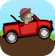

<h1 align="center">Hill Climb Racing</h1>

  <b>Newton Bill's ride up the hills, on the NumWorks calculator.</b> 
  Thirteen stages, thirteen vehicles and every one of their upgrades: drive as far as your fuel and Bill's neck allow.

  <a href="https://github.com/Mason363/NumPlay/releases/latest/download/HillClimbRacing.nwa"><b>Download HillClimbRacing.nwa</b></a>
  &nbsp;·&nbsp; <a href="#controls">Controls</a>

  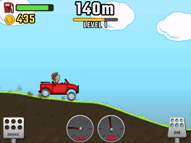

## Highlights

* **The game's own physics:** it runs on Box2D 2.2.1, the physics engine the game itself uses, 60 steps a second, with the game's own numbers read from its Android package: each vehicle's chassis, wheels, springs, engine, turbo, brakes, air control and downforce, each stage's gravity and grip, and the ground in pieces of half a meter. The Tractor's back wheel is a soft tire of 16 balls on springs, the Tourist Bus carries three passengers who go limp when they hit the ground, and the Snow Mobile rides on a ski and a track. The wheels hang on springs and the engine turns them against the chassis, so the nose rises when you floor it and you can flip over backwards on a steep hill. In the air, gas tilts you back and brake tilts you forward.
* **Bill's neck:** when his head touches the ground or a cave's roof, it's *Driver down*, and the run ends 4 seconds later. A tank lasts 40 seconds (vehicles with a Fuel upgrade burn theirs at their own rate, which the upgrade lowers), each fuel can fills it up, and the cans come at the stage's own spacing. When it runs dry you roll on for 4 more seconds.
* **Coins of 5, 25, 100 and 500**, bigger the further you go, in rows along the road. **Air time** pays from 0.75 s in the air, every 0.2 s: 25 for the first four steps, then *Big air time* 100 each, then *Insane air time* 500 each. Every **flip** and **back flip** pays 1,000, and a **neck flip** (going down in the middle of one) 2,500.
* **Levels, as in the game:** each stage has its own, kept from run to run. Reach the goal (200 m on the Countryside, then 400 m, 600 m...) and its bonus is paid; the next one waits for you, on this run or the next.
* **Thirteen stages**, each with its own ground, sky, grip, gravity and spacing of fuel, with the game's prices:

  | Stage | Price | |
  | --- | --- | --- |
  | Countryside | free | Rolling hills that get steep and jagged further on, and rope bridges that sag under you |
  | Desert | 35,000 | Steep dunes, and canyons with rope bridges further apart |
  | Arctic | 75,000 | The Countryside's hills, but on slippery snow |
  | Highway | 125,000 | Flat and fast at first; the fuel cans get further and further apart |
  | Cave | 150,000 | A ceiling over your head: hit it with Bill and it's over. Fuel every 150, 120 and 90 m |
  | Moon | 175,000 | Low gravity: long jumps, big air time and flips, the Earth in the sky |
  | Mars | 250,000 | Lighter than home, with tunnels now and then |
  | Alien Planet | 750,000 | A slimy, slippery, sloped world under a green night |
  | Arctic Cave | 800,000 | A cave of ice, slippery, with icicles hanging from its roof |
  | Forest | 850,000 | Bunches of pine trees in the way: ram them or push them over |
  | Mountain | 850,000 | Very bumpy and uphill nearly all the way, with rope bridges |
  | Mudpool | 1,000,000 | Pools of mud in its dips: you sink in and slow down, and push through with the gas |
  | Volcano | 1,000,000 | Ash and pools of lava: whatever touches the lava catches fire, and fire burns fuel fast |

* **Thirteen vehicles** that each drive their own way, in the game's order, with its prices and their four upgrades, each in the game's number of levels and at its prices:

  | Vehicle | Price | Upgrades |
  | --- | --- | --- |
  | Hill Climber | free | Engine, Suspension, Tires, 4WD |
  | Motocross Bike | 75,000 | Engine, Suspension, Tires, Air Control |
  | Monster Truck | 100,000 | Engine, Suspension, Tires, 4WD |
  | Tractor | 100,000 | Engine, Tires, Fuel, Stability |
  | Quad Bike | 175,000 | Engine, Suspension, Tires, 4WD |
  | Tourist Bus | 200,000 | Engine, Suspension, Tires, Fuel |
  | Race Car | 250,000 | Engine, Suspension, Tires, Downforce |
  | Super Diesel 4x4 | 500,000 | Engine, Suspension, Tires, Fuel |
  | Rally Car | 750,000 | Engine, Suspension, Tires, Downforce |
  | Tank | 1,000,000 | Engine, Suspension, Tracks, Fuel |
  | Snow Mobile | 1,000,000 | Engine, Suspension, Tracks, Fuel |
  | Truck | 1,000,000 | Engine, Suspension, Tires, Fuel |
  | Dune Buggy | 800,000 | Engine, Suspension, Tires, Fuel |

* **The game's own look:** its vehicles, wheels and Bill, its coins and fuel cans, each stage's sky, surface and ground, the pedals and the RPM and boost meters on the dashboard, the garage and the stage cards, all from the game itself.
* **Saved as you go:** coins, what you own and its upgrades, and your best distance on each stage with each vehicle. A run left halfway keeps its coins. The save is also copied into `hillclimb_saves.py`, so installing the app again doesn't erase it. Saves from earlier versions load with their coins and progress.

<table>
  <tr>
    <td align="center" width="33%">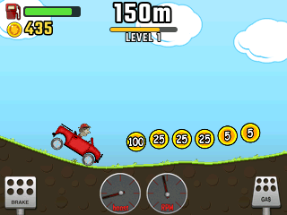 The Countryside</td>
    <td align="center" width="33%">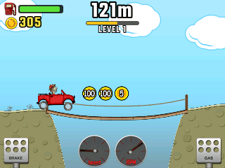 A rope bridge in the Desert</td>
    <td align="center" width="33%"> A back flip on the Moon</td>
  </tr>
  <tr>
    <td align="center">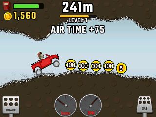 The Cave</td>
    <td align="center">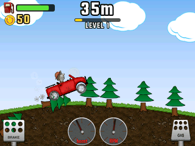 The Forest's trees</td>
    <td align="center">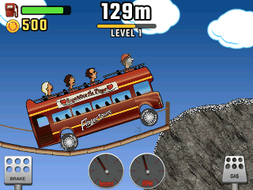 The Tourist Bus on the Mountain</td>
  </tr>
  <tr>
    <td align="center">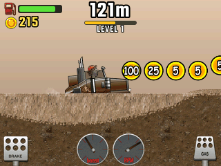 The Truck in the Mudpool</td>
    <td align="center">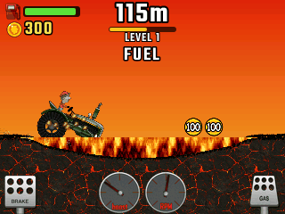 The Tractor in the Volcano's lava</td>
    <td align="center">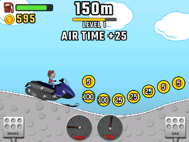 The Snow Mobile on the Arctic</td>
  </tr>
  <tr>
    <td align="center">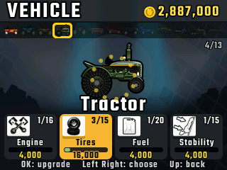 The garage</td>
    <td align="center">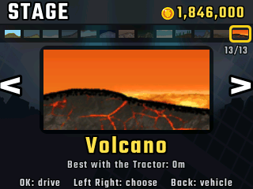 The stages</td>
    <td></td>
  </tr>
</table>

## Controls

| Key | Action |
| --- | --- |
| **Right**, **OK** or **EXE** (or 6) | Gas; in the air, tilt back |
| **Left** (or 4) | Brake, then reverse; in the air, tilt forward |
| **Back** | Pause: Resume, Restart, Garage, Quit game (it asks first) |
| **Home** or **On/Off** | Keep the run's coins and quit |
| In the menus | **Left**, **Right** to choose a vehicle or a stage (the strip at the top shows them all, the chosen one framed), **Down** to the upgrades, **OK** to buy or go, **Back** to go back. The line at the bottom says what each key does |

## Good to know

* **13 vehicles and 13 stages, as in version 1.10.2.** The game kept growing after that, to 44 vehicles and about as many stages. Those are left out: their code is only in builds without symbols, so how they drive can't be read from it, and the wiki has their prices and upgrades but not their physics. The Moonlander and the Onewheeler are in 1.10.2's code, but weren't on sale yet, so they're left out too.
* **Upgrades as in the game.** The Monster Truck, Quad Bike, Race Car, Rally Car, Dune Buggy and Tank now have the game's last levels and prices. An old save with an upgrade past its new last level is lowered to it, and the coins paid for the levels taken off come back.
* **The Tractor's soft tire** is the game's 16 balls on springs, but it is drawn as a round tire that grows and shrinks with them rather than bending.
* **Lava only burns fuel.** As in the game, mud and lava never count as touching Bill's head: only the ground under them does.

## Credits

**Hill Climb Racing** is [Fingersoft](https://fingersoft.com)'s game (2012), with Newton Bill at the wheel. This version is written in C and C++ for NumPlay. How it plays is the game's own: the vehicles, the stages' ground, gravity and grip, the bridges, pits and trees, the coins, fuel, levels, prices and bonuses follow the numbers and rules read from the game's Android package (versions 1.0 to 1.70, mostly 1.10 and 1.16; the five vehicles and three stages added here from 1.10.2), and were checked against videos of the game. Its pictures (the vehicles, Bill, the coins, the stages' grounds and skies, the pedals, meters, icons and the logo) are the game's own, as the [Hill Climb Racing Wiki](https://hillclimbracing.fandom.com) keeps them, or taken from the game's 1.10.2 Android package where the wiki has no copy (the Tractor, the Tourist Bus and its passengers, the Super Diesel 4x4, the Truck, and the Mountain's, Mudpool's and Volcano's grounds, skies, mud, lava and fire). Its text is set in **Teko** (SIL Open Font License, [license](../../LICENSES/OFL-1.1-Teko.txt)). It is an unofficial fan game, not affiliated with Fingersoft.

The physics is **Box2D 2.2.1** by Erin Catto (zlib license, [src/box2d/License.txt](src/box2d/License.txt)), the version the game is built with, cut down to the parts the game uses. The files changed to fit the calculator say so at their top.

`tools/fetch.py` gathers the wiki's pictures, the game's 1.10.2 Android package for the pictures the wiki lacks, and the font, and `tools/pack.py` turns them into `src/data.bin` (committed, so building needs no network).

Build: `make` (needs `arm-none-eabi-gcc` and `arm-none-eabi-g++`, and Node.js for nwlink). `make test` plays it on a computer with the sanitizers (tests/check.py).
