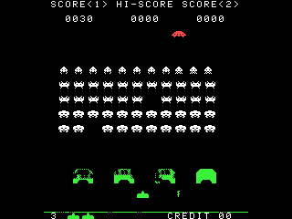

# Space Invaders

Taito's arcade game of 1978 on the NumWorks calculator, as it plays on the Midway cabinet: the rack of invaders marching down, the four bunkers, the mystery saucer, the white picture under its strips of red and green film.

- **The arcade's own picture,** pixel for pixel: 224 by 256, in the middle of the calculator's screen, with the arcade's letters, invaders, cannon, saucer and bursts, and its coloured film (red over the saucer, green over the bunkers and the cannon).
- **The rack moves one invader at a time,** one each frame, as in the arcade: the fewer are left, the faster they go, the last one fastest of all. It drops at each edge, and each wave starts lower down, until the rack starts right above the bunkers.
- **Squids 30, crabs 20, octopuses 10,** and the **mystery saucer** for 50, 100, 150 or 300, from how many shots you have fired: the 23rd shot hits it for 300, then every 15th.
- **The invaders' three shots:** the rolling one comes down the column above your cannon, the plunger and the squiggly one from columns in a fixed order. They wait for each other less and less as your score grows.
- **Bunkers that wear away** pixel by pixel, from above and below, and that the invaders wipe out as they come down. The ground wears away too.
- **A new cannon at 1500 points**, 3 to start with. The invaders win if they land.
- **The attract screen** types out PLAY SPACE INVADERS and the score advance table, and your best score is kept.

## Controls

| Key | Action |
| --- | --- |
| Left, Right (or 4, 6) | Move the cannon |
| OK, EXE or Up (or 8) | Fire (a new press each shot, as in the arcade) |
| OK | On the attract screen: play |
| Back | Pause: Resume, Quit game |
| Home | Quit |

## Credits

Space Invaders is **Tomohiro Nishikado**'s game for **Taito** (1978), sold in America by **Midway**. This version is written in C for NumPlay from the arcade's rules, with no code from it; its pictures are redrawn from the arcade's.

It draws the way the arcade does: everything is wiped and drawn again in a picture of one bit a pixel, a shot hits whatever it finds lit there, and a burst leaves its shape cut out of the bunkers when it goes. `make test` lets a bot play an hour of the game on a computer, with the sanitizers: it clears a wave, hits the saucer, loses games and starts again.

Inside NumPlay it draws its menus with the launcher's shapes and fonts and saves through its file functions, so the game itself is about 5 KB.

It comes inside [NumPlay](https://github.com/Mason363/NumPlay), or on its own as `SpaceInvaders.nwa` from the [latest release](https://github.com/Mason363/NumPlay/releases/latest).

Build: `make` (needs `arm-none-eabi-gcc` and Node.js for nwlink).
