> **The Binding of Isaac is a [NumPlay](../../README.md) game that comes on its own.** It is too big to sit next to NumPlay. Get `BindingOfIsaac.nwa` from the [latest release](https://github.com/Mason363/NumPlay/releases/latest).

  

<h1 align="center">The Binding of Isaac</h1>

  <b>Cry your way down through the basement, on the NumWorks calculator.</b> 
  A whole run, as Rebirth plays it: the Basement, the Caves, the Depths and the Womb, Mom and her heart, then down to Sheol or up to the Cathedral.

  <a href="https://github.com/Mason363/NumPlay/releases/latest/download/BindingOfIsaac.nwa"><b>Download BindingOfIsaac.nwa</b></a>
  &nbsp;·&nbsp; <a href="#controls">Controls</a>

  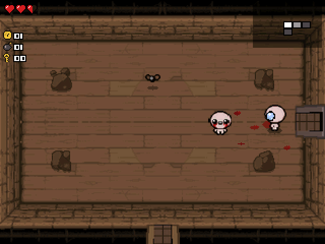

## Highlights

* **Floors laid out as the game lays them out:** every floor is new, grown room by room the way the original does it (a tree of rooms from the start, between 7 and 20 of them), with the boss's room at its far end, the treasure room and the shop in other dead ends, a secret room tucked between rooms and a super secret room behind a lone wall.
* **Nine floors and their looks:** the Basement or the Cellar, the Caves or the Catacombs, the Depths or the Necropolis, the Womb or Utero (each floor picks one of the two), then Sheol or the Cathedral, each with its own walls, floor and rocks from the game.
* **The rooms of a floor:** 37 layouts of rocks, poop, pits, spikes, fire places, TNT and cobwebs, each filled with a group of the floor's monsters (49 groups); tinted rocks to bomb for what's inside, champions that hit harder and drop something, rewards for clearing a room, and doors that shut until it's cleared.
* **Special rooms:** treasure rooms, shops with their shopkeeper, the boss's room, secret and super secret rooms (bomb the right wall), curse rooms behind spiked doors, arcades with slot machines, the blood donation machine, the fortune teller and beggars, sacrifice rooms, libraries, the seven deadly sins' rooms, challenge rooms, and after a boss, sometimes, the Devil's room (items for your heart containers) or an angel's.
* **180 items, by their names in the game and doing what they do:** stat ups (The Sad Onion, Cricket's Head, Magic Mushroom, Pentagram...), tears that change (The Inner Eye, Spoon Bender, Polyphemus, The Parasite, Cupid's Arrow, Ipecac, Mutant Spider, 20/20, Proptosis, Tough Love, A Lump of Coal...), Brimstone's charged laser, Technology's lasers, Mom's Knife, Dr. Fetus's bombs, Chocolate Milk's charge, familiars (Brother Bobby, Sister Maggy, Demon Baby, Robo-Baby, Little Steven, Guardian Angel, Halo of Flies, Abel, Bum Friend...), active items with their charges (The Bible, The Book of Belial, The Necronomicon, The D6, Yum Heart, Mom's Bra, Shoop da Whoop!, Crack the Sky, Teleport!...), and each from the pools of the rooms it comes from.
* **87 monsters, as they move in the game:** Gapers, Flies and Attack Flies, Pooters, Horfs, Clotties, Hosts that hide in their skulls, Hoppers and Leapers, Chargers and Knights, Globins that get back up, Boom Flies, Maws, Spiders, Fatties, Bonies that throw bones, Babies that vanish, Vis and Eyes with their beams, Leeches, burrowing worms, Mom's Hand coming down from above... from the game's own pictures.
* **42 bosses and the seven deadly sins:** Monstro, Larry Jr., the Duke of Flies, Gemini, Gurdy Jr., Famine, Steven, the Widow, Pin, the Haunt, Dingle, the Blighted Ovum, Chub, Gurdy, Peep, Pestilence, the Carrion Queen, Mega Fatty, Polycephalus, the Husk, Monstro II, Loki, War, the Mask of Infamy, Gish, the Bloat, the Wretched, the Dark One, Blastocyst, Daddy Long Legs, Scolex, Death, Lokii, Conquest, Mama Gurdy, Mr. Fred, Triachnid, Teratoma, then Mom (her eye in the doors, her hand, her foot), Mom's Heart, Satan and Isaac; each with its "VS" screen.
* **Isaac's health as the game keeps it:** red heart containers, soul and black hearts (a black heart lost hurts the whole room), eternal hearts, up to twelve; coins, bombs and keys; pills (thirteen colours, their effects new each run, found out by taking them) and the tarot and playing cards.
* **Eight characters with Rebirth's stats and starting items:** Isaac, Magdalene (Yum Heart), Cain (Lucky Foot), Judas (The Book of Belial), then, once won, ???, Eve, Samson and Azazel.
* **The endings:** Mom's, Mom's Heart's, Satan's and Isaac's, and the bosses you've beaten marked on the menu.
* **Kept like the game keeps a run:** Home (or the pause menu) keeps the run where you are, the next start continues it. Your run and progress are also copied into `isaac_saves.py`, so installing the app again doesn't erase them.

<table>
  <tr>
    <td align="center">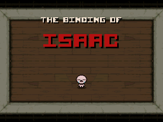 Isaac's room</td>
    <td align="center">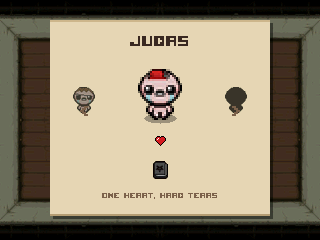 Choose who plays</td>
  </tr>
  <tr>
    <td align="center">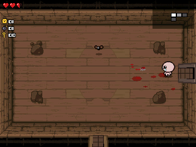 The Basement</td>
    <td align="center">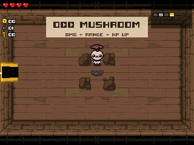 A treasure room's item</td>
  </tr>
  <tr>
    <td align="center">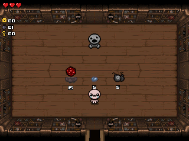 The shop</td>
    <td align="center">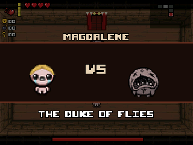 Every boss has its VS screen</td>
  </tr>
  <tr>
    <td align="center">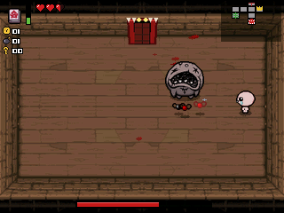 Monstro</td>
    <td align="center">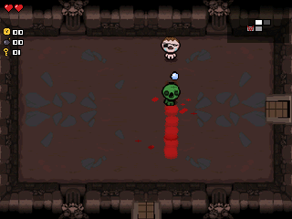 The Catacombs</td>
  </tr>
  <tr>
    <td align="center">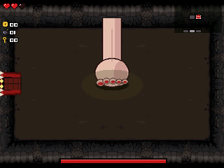 Mom's foot</td>
    <td align="center">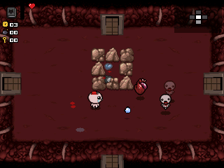 The Womb</td>
  </tr>
  <tr>
    <td align="center">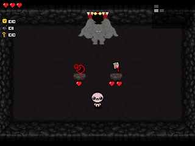 A deal with the Devil</td>
    <td align="center">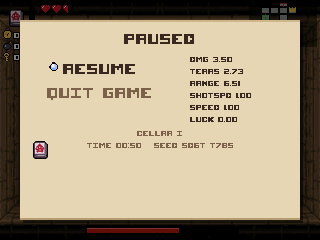 Paused: the stats, the items, the run's time and seed</td>
  </tr>
</table>

## How to play

A run starts in a room with four doors. Each room you walk into shuts its doors until every monster in it is dead: cry your tears at them, keep out of their way and of their shots. Clearing a room can leave something behind: coins, hearts, bombs, keys, a chest, a pill or a card. The map in the top right shows the rooms you know of.

Find the treasure room (the golden door) for an item, the shop for more, and the boss's room (the red door with teeth). Beat the boss and take the trapdoor down to the next floor. From the second floor, treasure rooms and shops are locked: a key opens them. A bomb next to a wall where a room should be may open a secret room. After a boss, a door to the Devil's room may open, where an item costs heart containers, or to an angel's room, where it's free.

Walk over an item to take it: the game names it and says what it does. Active items have a charge bar beside them, filled by clearing rooms. A pill does something different each run (you learn what by taking it), and each card has its own effect.

Mom waits at the end of the Depths, and her heart at the end of the Womb. Beyond, Sheol leads to Satan, and the Cathedral to Isaac himself.

## Controls

| Key | What it does |
| --- | --- |
| Arrows | Walk |
| 8, 4, 6, 2 (or 5) | Cry tears up, left, right, down (the game's arrow keys) |
| 9, Shift or × | Drop a bomb |
| 7, Alpha or OK | Use the active item |
| 1, 3 or − | Take the pill or use the card you hold |
| Toolbox, Var or x,n,t | Hold to see the whole map |
| Back | Pause: Resume, or Quit game (the run is kept) |
| Home | Keep the run and quit |

On the menu, **Controls** swaps the two: the number keys walk (as W A S D) and the arrows cry.

## Good to know

* **One app at a time:** The Binding of Isaac is too big to sit next to NumPlay or the other big games. Installing it from the NumWorks website swaps them out, and installing them again swaps it out. Your saves in each one are kept.
* **What isn't in it:** the bigger rooms (two cells wide or tall), trinkets, the Chest and the Dark Room past Satan and Isaac, Greed mode and the challenges. The characters past the eight above, and Rebirth's later expansions, aren't in it either.
* **No music or sound:** the calculator has no speaker.
* **The same game:** the floors grow the way the original's do, the pictures are the game's (from the room editor its modders use), and the items, monsters and bosses do what they do in Rebirth, at its 30 frames a second, with room layouts of our own in its style.

## Credits

**The Binding of Isaac** is by **Edmund McMillen** and **Florian Himsl** (2011), and **The Binding of Isaac: Rebirth** by **Nicalis** and Edmund McMillen (2014). This is an independent fan version, written in C for NumPlay. Its pictures are the game's own, from the resources of [Basement Renovator](https://github.com/Basement-Renovator/basement-renovator), the room editor of the game's modders; the doors, the HUD and the other characters' looks are drawn from Isaac's own picture for this version. The titles use **Upheaval** by Brian Kent (freeware). Not affiliated with Edmund McMillen, Florian Himsl or Nicalis.

It comes on its own as `BindingOfIsaac.nwa` from the [latest release](https://github.com/Mason363/NumPlay/releases/latest).

Build: `make` (needs `arm-none-eabi-gcc` and Node.js for nwlink); `make host test` plays it on a computer with the sanitizers. `make data REF=<folder>` remakes `src/data.bin` from what `tools/fetch.py` downloads, and `python3 tools/media.py` the pictures above.
