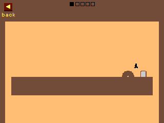
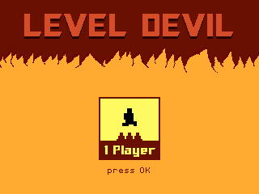
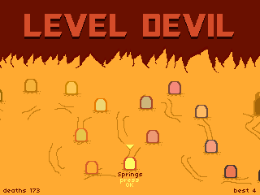
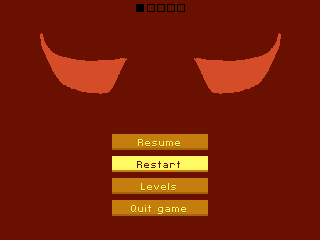

# Level Devil

Run to the door. The level has other plans. Unept's troll platformer on the NumWorks calculator, with the game's own rooms and the game's own pictures: all sixteen worlds of five rooms, their traps and their timing, in the game's flat colours with its tiny black runner.

- **The 80 rooms of the game, in its order:** Pits, Spikes, Push, Coins, Controls, Platforms, Springs, Warps, Scale, Doors, Saws, Flappy, Gravity, Movement, Wraparound and the Boss, each in its own colours. Clear a world's five rooms to open the next one.
- **The game's traps, as it times them:** floors that drop or slide away, spikes that pop up in waves, walls that push you into pits, coins over fake ground, controls that turn round, platforms that sink under you, springs and warps that send you the wrong way, a runner that grows and shrinks, doors that run off or swap places with you, saws that chase you, gravity that flips, rooms where you fly, slide, float or wrap round the screen, and the Devil's giant saw.
- **Its feel:** the runner's speed, jump and gravity, its five-step grace after running off an edge, springs, ice and moving platforms that carry you.
- **Its pictures, all of them the game's:** the runner running, jumping and flapping, its pieces flying apart when it dies or warps and coming together again; the doors and their shutting, spikes, saws, springs, warps, buttons, coins and their sparks, and the arrow keys under the first room; the five squares of the world's rooms, its back button and its PRESS ANY KEY.
- **Its screens:** the jaws with the Devil's eyes that shut between two rooms, the title with its 1 Player card, and the map of the worlds, with the game's sixteen portals on their paths: the one you pick lit up, the open ones in their world's colours, the locked ones dark. The pause is the shut jaws with the game's buttons on them.
- **Deaths counted,** for the world and in all, with your best (the fewest deaths) for each one. The game remembers the room you reached, so you can stop any time, and keeps a copy of its save in `leveldevil_saves.py`, so installing the app again doesn't erase it.

  

## Controls

| Key | Action |
| --- | --- |
| Left, Right (or 4, 6) | Run |
| Up, OK or EXE (or 8, 5) | Jump (in Gravity: turn gravity round; in Flappy: flap) |
| Down (or 2) | Jump, in the room that says so |
| Any key, once dead | Try again |
| Left, Right on the map | The world before, the world after |
| Up, Down on the map | The nearest world up, down |
| OK on the title, on the map | Play |
| Back | Pause: Resume, Restart the room, Levels, Quit game (it asks first) |
| Home | Save and quit |

## Credits

[Level Devil - NOT A Troll Game](https://store.steampowered.com/app/3242750/) is **Unept**'s game (Adam Corey, 2023). This version is written in C for the calculator, with no code of the original. What it shows and plays is the original's, taken from the game's web build (a Stencyl game):

- its rooms: [tools/fetch.py](tools/fetch.py) takes each room's tiles and actors (where each one is, its type, size and turn) and keeps them in [tools/scenes.json](tools/scenes.json), and [tools/rooms.py](tools/rooms.py) has what each room's script does (what each trigger sets off, after how long, how far and how fast), written out from the game's scene scripts. The runner's speeds and jump, the gravity of each room and the colours of each world are the game's;
- its pictures and its two pixel fonts: [tools/pictures.py](tools/pictures.py) takes them from the game's packed library (its 1x pictures, each sprite's frames as the game's resources name them) and packs them into [src/pictures.h](src/pictures.h), with the game's way of painting its traps in each world's colour (their grey swapped for the ground's);
- its screens: the title, the map and its portals where the game puts them, the jaws and when they shut, the door shutting and the room squares, timed as the game times them.

Not affiliated with Unept. On the keypad, the game's mouse and desktop buttons (mute, settings, speedrun, ads, costumes) and its 2 Player mode are left out; the map shows the world you pick, where the game shows the one to play next, and scrolls, as the calculator's screen is narrower than the game's. The rooms are drawn at 3/4 of their size to fit the screen whole; the jaws, the title, the map and the writing are drawn as the game has them.

`make test` plays the rooms through on a computer with the keys in [tests/solutions.txt](tests/solutions.txt) (found by a search, `build/play search`, or written by hand): 75 of the 80 are cleared that way. For the other five (Scale 4, Gravity 4, Movement 3 and Wraparound 4 and 5), no keys have been found yet, so it plays a walk that sets their traps off without the runner dying. `build/play screens DIR` and `build/play rooms DIR` draw the screens and the rooms.

It comes as its own app, `LevelDevil.nwa`, from the [latest release](https://github.com/Mason363/NumPlay/releases/latest).

Build: `make` (needs `arm-none-eabi-gcc`, Python 3 and Node.js for nwlink). `python3 tools/pictures.py` packs the pictures again (it downloads the game's web build, or reads it with `--from DIR`).
