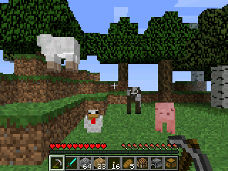

# NumBlocks

Minecraft 1.8.8 on your NumWorks calculator. NumBlocks isn't a look-alike: it follows Minecraft 1.8.8 exactly, so a seed gives you the very same world that Minecraft 1.8.8 makes, block for block, with its blocks, items, recipes, mobs, textures, font and screens.

- **The same worlds as Minecraft 1.8.8:** type a seed and you get the world Minecraft 1.8.8 makes, block for block: the same terrain, biomes, hills, caves, lakes and trees. Or a superflat world to build on.
- **Survival:** health, hunger, day and night, zombies, skeletons, creepers and spiders, and pigs, cows, sheep and chickens.
- **Weather:** rain, snow and thunderstorms with lightning, as often as in 1.8.
- **The Nether:** the Nether Wastes, Crimson Forest, Warped Forest and Soul Sand Valley, each
  with its own ground, growth and fog. Crimson and warped fungi, stems, wart blocks, roots and
  vines grow above the lava sea; soul sand, soul soil and soul fire make the valley. Piglins
  hunt you in the wastes and crimson forest; zombified piglins stay neutral until attacked.
- **Crafting:** 142 items and 214 recipes, a furnace, chests, tools that wear out, armor.
- **Fishing:** cast, wait for the bite, reel in fish, junk or treasure.
- **Building:** over 230 kinds of blocks, doors, beds to sleep through the night, stairs, torches that light up caves, flowing water and lava, farms that grow.
- **Fire:** light it with flint and steel. It spreads and burns wood, leaves and wool, like in 1.8.
- **Creative mode:** fly, every block and item, break things at once, and search for any block. With cheats on, the Operator Utilities tab holds Minecraft's barrier — the block you only see holding one.
- **Spectator mode:** fly through the blocks and see through them, nothing to touch, and OK on a mob sees the world through its eyes.
- **Commands:** /gamemode, /give, /time, /weather, /tp and more, with cheats on (Allow Cheats, or Open to LAN).
- **Your worlds:** keep several, give them names, and they save as you play and when you quit. A copy also goes into `numblocks_saves.py`, so installing the game again doesn't erase them.
- **Not in yet:** the End, redstone circuits and pistons, villages and other structures, enchanting and brewing.

## Controls

| Key | What it does |
| --- | --- |
| Arrows | Look around |
| , π √ x² | Walk forward, left, back, right (like W, A, S, D) |
| shift | Jump (twice in Creative: fly) |
| alpha | Sneak (in Spectator: sink while flying, leave a mob's eyes) |
| i | Sprint |
| OK | Mine, attack (like the left mouse button) |
| Back | Place, use, eat (like the right mouse button) |
| var | Inventory |
| 1 to 9 | Pick a hotbar slot |
| x,n,t | Drop the item |
| log | Pick the block you look at |
| × | Chat |
| ÷ | Type a command (toolbox finishes words) |
| ans | Pause |
| sin + cos | Game mode switcher: Creative / Survival / Spectator (needs cheats) |
| Home | Save and quit |

You can change these keys in Options, then Controls, where Sprint chooses between holding the i key and switching sprinting on with a tap. Press sin and cos together to switch game mode, as modern Minecraft does with F3 and F4: the modes appear in the middle of the screen with the one last used outlined, cos moves the outline along them, and letting go of sin (or pressing OK) takes the one outlined — Back leaves without changing anything. It needs cheats on, which Open to LAN gives, and without them the chat says so, as with the command it runs. In the inventory, the arrows move between slots, OK picks up or puts down, EXE takes or leaves one, and shift with OK moves a whole stack. To spread a stack, hold OK and move over the slots: it splits evenly when you let go (hold EXE to drop one in each). In Creative, the Search Items tab finds blocks as you type, and shift with up or down jumps to the top or bottom of a tab. The game shows these keys the first time you open it, and again from Options, then Controls.

Spectator, as `/gamemode spectator` or the switcher's third slot, is Minecraft's: you always fly, through every block, with nothing to touch — no mining, placing, eating or opening, no damage, and no mob noticing you, so the world goes on living around you. Its whole HUD is the crosshair, and that only while it is on a mob: OK then sees the world through that mob's eyes, at its eye height, turning where it looks, until alpha brings you back to your own flying body. Flying into the ground, the rock around your head turns see-through — you see the cave walls and the grass above through the stone, as in Minecraft.

## Get it

It comes on its own as `NumBlocks.nwa` from the [latest release](https://github.com/thatbignguy/NumPlay/releases/latest). (In this fork it is not inside NumPlay.nwa: install it on its own, or as `numblocks-interest.nwa`, hidden in the Interest app.)

## Credits

Inspired by Minecraft, but not affiliated with Mojang or Microsoft. Go play the real Minecraft and support the people who made it! The textures, the font and the screens come from Minecraft 1.8.8, and the world is made the way Minecraft 1.8.8 makes it.

Also try [Numcraft](https://github.com/yannis300307/NumcraftRust) by yannis300307, the first Minecraft-like game for the NumWorks.

Made by Mason Chen as part of NumPlay.

## License

The game's code is licensed under the GNU General Public License v3.0: see the `LICENSE` file at the root of the repository. The textures, font and screens come from Minecraft 1.8.8 and belong to Mojang: they are not covered (see Credits).
