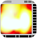
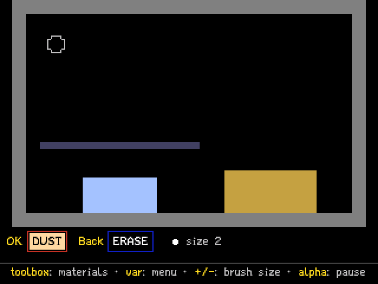
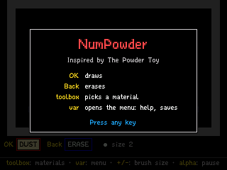
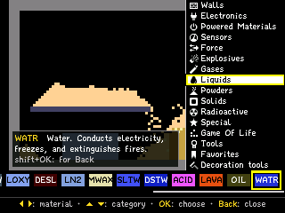
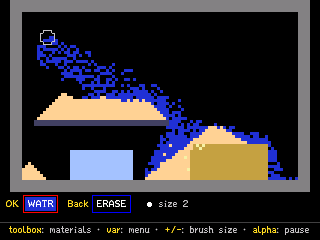
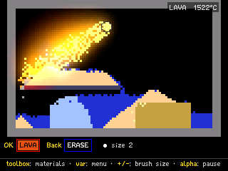
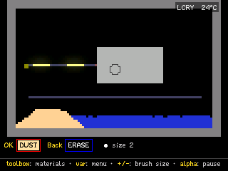
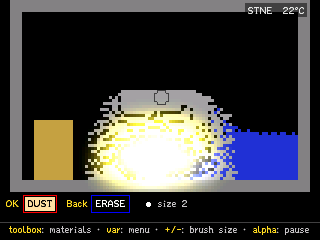
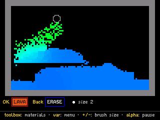
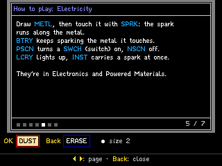

> **NumPowder is a [NumPlay](../../README.md) game that comes on its own.** It is too big to fit next to NumPlay on the calculator. Get `NumPowder.nwa` from the [latest release](https://github.com/Mason363/NumPlay/releases/latest).

  

<h1 align="center">NumPowder</h1>

  <b>The Powder Toy on the NumWorks calculator.</b> 
  Sand, water, fire, acid, electricity and 175 materials to mix, melt, burn and blow up.

  <a href="https://github.com/Mason363/NumPlay/releases/latest/download/NumPowder.nwa"><b>Download NumPowder.nwa</b></a>
  &nbsp;·&nbsp; <a href="#controls">Controls</a>

  

## Highlights

* **The Powder Toy's materials:** 175 of them, from sand, water and wood to metal, silicon, acid, lava, nitroglycerin, plutonium, clone, black holes and the Game of Life, each with its behaviour from the original's code.
* **Things react:** sand sinks in water, fire burns wood, lava melts ice and boils water, acid eats through most things.
* **Heat and air:** everything has a temperature, so things melt, boil and freeze; explosions push the air around them.
* **Electricity:** sparks run along metal, silicon makes switches and logic, batteries keep things powered.
* **Walls, tools and views:** 17 kinds of walls, tools to heat, cool and push air, and the original's display modes, from fire to heat and pressure.
* **Keep your creations:** four save slots and an autosave when you press Home, copied into `numpowder_saves.py` so installing the app again doesn't erase them.

<table>
  <tr>
    <td align="center"> The welcome card shows the four keys you need</td>
    <td align="center"> toolbox opens the materials, by category</td>
  </tr>
  <tr>
    <td align="center"> Sand piles up and water flows around it</td>
    <td align="center"> Lava melts the ice and boils the water</td>
  </tr>
  <tr>
    <td align="center"> A battery sends sparks along metal</td>
    <td align="center"> C-4 throws the stone around</td>
  </tr>
  <tr>
    <td align="center"> The heat display shows every temperature</td>
    <td align="center"> How to play, in the menu</td>
  </tr>
</table>

## How to play

Pick a material and draw with it. Press **toolbox** to open the materials: left and right pick one, up and down change the category, and **OK** takes it. Then move the brush with the arrows and hold **OK** to draw, or **Back** to erase. The bar at the bottom always shows what **OK** and **Back** draw with, and the line under it says what the keys do right now.

Try things together: sand on water, fire on wood, lava on ice, acid on anything. For electricity, draw metal (METL), then touch it with a spark (SPRK). **How to play**, in the menu (**var**), has more ideas.

## Controls

| Key | What it does |
| --- | --- |
| Arrows | Move the brush (shift: 4 at a time) |
| OK | Draw with the OK material |
| Back | Draw with the Back tool (ERASE at first) |
| toolbox | The materials: left and right pick, up and down change category, OK takes it, shift+OK for Back |
| var | The menu: How to play, keys, save, load, clear, display, settings, credits |
| + and - | The brush's size (shift: its shape) |
| shift+OK | Draw a line, a box (⌫) or fill |
| ⌫ | Take the material under the brush |
| alpha | Pause (shift+alpha: one frame) |
| Home | Save and quit |

## Good to know

* **On its own:** NumPowder is too big to fit next to NumPlay. Installing it from the NumWorks website swaps out NumPlay and the other apps, and installing NumPlay again swaps it back out. Your saves in each one are kept.
* **A smaller world:** the play area is 100 by 64 particles, each 3 pixels wide, and holds up to about 4,400 particles at once (about 3,600 on custom builds of the calculator's software, which give apps less memory).
* **The edges are solid:** things stop at the screen's edges. In Settings, Edges can make them fall out instead, as in the original, or come back on the other side.
* **Left out:** decorations (painting colours over particles), signs, and custom Game of Life rules. There is no sound.

## Credits

Inspired by [The Powder Toy](https://powdertoy.co.uk), not affiliated with its developers.

* The materials' behaviour, the font and the icons are ported from [The Powder Toy's source code](https://github.com/The-Powder-Toy/The-Powder-Toy) (GNU General Public License v3.0), by Stanislaw K Skowronek, Simon Robertshaw and its many contributors.

Made by Mason Chen as part of NumPlay.

## License

NumPowder's code is licensed under the GNU General Public License v3.0, like The Powder Toy it is ported from: see the `LICENSE` file at the root of the repository.
