> **Plants vs. Zombies is a [NumPlay](../../README.md) game that comes on its own.** It is too big to sit next to NumPlay. Get `PlantsVsZombies.nwa` from the [latest release](https://github.com/Mason363/NumPlay/releases/latest).

  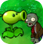

<h1 align="center">Plants vs. Zombies</h1>

  <b>Zombies are coming to your house: plant your lawn to stop them, on the NumWorks calculator.</b> 
  The whole Adventure: 50 levels from the front lawn to the roof, 40 plants, 24 zombies, Crazy Dave, his shop, the Almanac, and Dr. Zomboss in his Zombot.

  <a href="https://github.com/Mason363/NumPlay/releases/latest/download/PlantsVsZombies.nwa"><b>Download PlantsVsZombies.nwa</b></a>
  &nbsp;·&nbsp; <a href="#controls">Controls</a>

  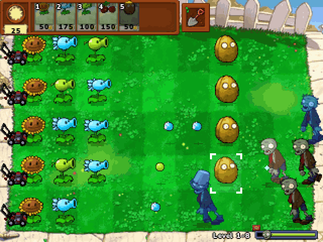

## Highlights

* **The whole Adventure, 50 levels:** the front lawn by day, then by night with its graves, the backyard's pool, the pool in the fog, and the roof, each world of ten levels with its own rules: no sun from the sky at night, mushrooms asleep in the day (wake them with a Coffee Bean), lanes of water that need Lily Pads, fog that hides the zombies until a Plantern lights it or a Blover blows it away, and a sloped roof where only lobbed shots get over the tiles, every plant in a Flower Pot.
* **Its levels as the game makes them:** the same zombies in each level, the same waves built the same way, with their flags, "A Huge Wave of Zombies is Approaching!" and the Final Wave, graves that rise at night, zombies climbing out of the pool and bungee zombies dropping on the roof. The sod is rolled out row by row on the first levels, and the plant you find at the end of each one waits on the lawn.
* **40 plants:** Peashooter, Sunflower, Cherry Bomb, Wall-nut, Potato Mine, Snow Pea, Chomper, Repeater; Puff-shroom, Sun-shroom, Fume-shroom, Grave Buster, Hypno-shroom, Scaredy-shroom, Ice-shroom, Doom-shroom; Lily Pad, Squash, Threepeater, Tangle Kelp, Jalapeno, Spikeweed, Torchwood, Tall-nut; Sea-shroom, Plantern, Cactus, Blover, Split Pea, Starfruit, Pumpkin, Magnet-shroom; Cabbage-pult, Flower Pot, Kernel-pult, Coffee Bean, Garlic, Umbrella Leaf, Marigold and Melon-pult, each with the game's cost, recharge, health, damage and timing.
* **24 zombies, each with its own trick:** the Flag Zombie, Conehead and Buckethead, the Pole Vaulting Zombie who jumps your first plant, the Newspaper Zombie who gets angry when you tear his paper, the Screen Door Zombie, the Football Zombie, the Dancing Zombie and his Backup Dancers, the Ducky Tube, Snorkel and Dolphin Rider zombies in the pool, the Zomboni and its ice trail, the Zombie Bobsled Team, the Jack-in-the-Box Zombie, the Balloon Zombie floating over your plants, the Digger Zombie who comes up behind them, the Pogo Zombie, the Bungee Zombie who steals a plant, the Ladder Zombie, the Catapult Zombie and its basketballs, and the Gargantuar, who throws his Imp over your defenses.
* **The mini-games of the Adventure:** Wall-nut Bowling, Whack-a-Zombie with a mallet, Big Trouble Little Zombie, Vasebreaker and Bungee Blitz, and the conveyor-belt levels that end each world.
* **Dr. Zomboss:** the Zombot on the roof at night, summoning zombies, stomping your plants, dropping a camper van, sending bungees, and lowering his head to spit fire and ice balls (Ice-shroom puts out the fire, Jalapeno melts the ice), until he goes down.
* **Crazy Dave** and what he has to say before the levels, **his shop**, Crazy Dave's Twiddydinkies (more seed slots, the Pool Cleaner, the Roof Cleaner, the rake and Wall-nut First Aid), paid with the coins zombies drop, and **the Almanac**, with every plant and zombie you have met.
* **Lawn mowers** in every lane, the shovel, choosing your seeds before each level, "the zombies ate your brains!", the trophy at the end, and Adventure again once it is done.
* **Saves:** your progress is saved after each level, and Home keeps the level you are playing: Continue in the menu brings it back. Both are also copied into `pvz_saves.py`, so installing the app again doesn't erase them.

<table>
  <tr>
    <td align="center">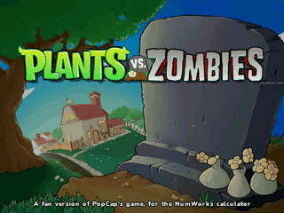 The title</td>
    <td align="center">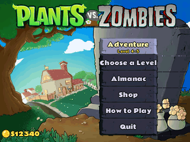 The menu on the tombstone</td>
  </tr>
  <tr>
    <td align="center">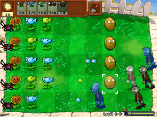 The front lawn: sunflowers, snow peas and wall-nuts</td>
    <td align="center">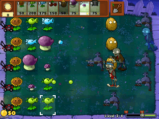 Night: graves, mushrooms and a pole vaulter</td>
  </tr>
  <tr>
    <td align="center">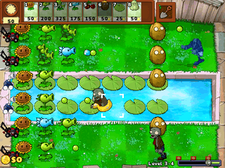 The backyard's pool and its lily pads</td>
    <td align="center">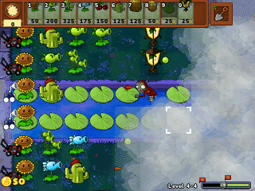 The fog, lit by planterns</td>
  </tr>
  <tr>
    <td align="center">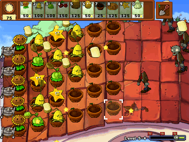 The roof: everything in flower pots, lobbed over the slope</td>
    <td align="center">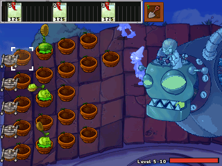 Dr. Zomboss, frozen by an Ice-shroom</td>
  </tr>
  <tr>
    <td align="center">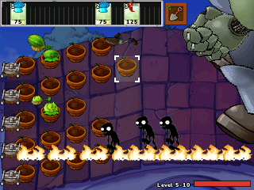 A Jalapeno burns a lane before the Zombot</td>
    <td align="center">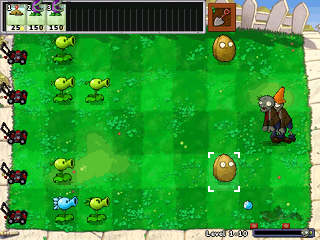 A conveyor-belt level</td>
  </tr>
  <tr>
    <td align="center">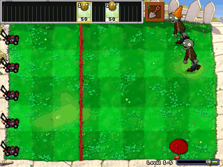 Wall-nut Bowling</td>
    <td align="center">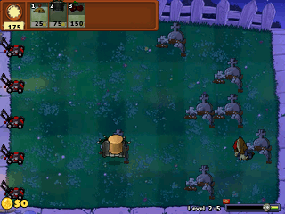 Whack-a-Zombie</td>
  </tr>
  <tr>
    <td align="center">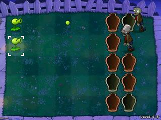 Vasebreaker</td>
    <td align="center">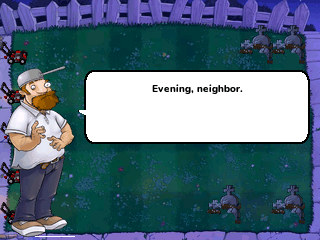 Crazy Dave</td>
  </tr>
  <tr>
    <td align="center">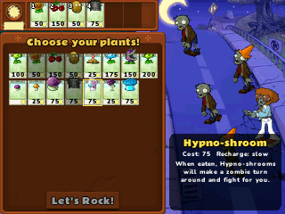 Choose your plants!</td>
    <td align="center">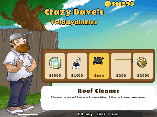 Crazy Dave's Twiddydinkies</td>
  </tr>
  <tr>
    <td align="center">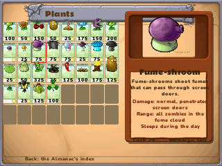 The Almanac</td>
    <td align="center">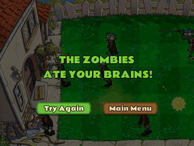 The zombies ate your brains!</td>
  </tr>
</table>

## Controls

| Key | What it does |
| --- | --- |
| Arrows | Move over the lawn, choose in the menus |
| 1 to 9, 0 | Pick the seed packet with that number (from the conveyor belt too) |
| OK or EXE | Plant it, whack a zombie, break a vase, confirm |
| The cursor | Moving it over sun and coins picks them up |
| ⌫ (Delete) | The shovel: then OK digs up a plant |
| Back | Put the seed back, or pause: Back to Game, Restart Level, Main Menu, Quit Game |
| Toolbox | The Almanac, in the menu |
| Home or On/Off | Keep the level and quit: Continue brings it back |

## Good to know

* **One app at a time:** Plants vs. Zombies is too big to sit next to NumPlay or the other big games. Installing it from the NumWorks website swaps them out, and installing them again swaps it out. Your saves in each one are kept.
* **The Adventure, not the rest:** the mini-games, puzzles and survival modes of the main menu, the Zen Garden and the plants sold in the shop (Gatling Pea, Twin Sunflower and the other upgrades, the Imitater) aren't in it, and neither is the Yeti, who only shows up in a second Adventure.
* **No music or sound:** the calculator has no speaker.
* **The same game:** the pictures are the game's own, scaled to the calculator's screen, and the rules, numbers and Crazy Dave's lines follow the game, at its own 100 updates a second.

## Credits

Inspired by Plants vs. Zombies by PopCap Games, not affiliated with PopCap Games or Electronic Arts.

* The pictures, the animations and the rules' numbers come from [pvz-web](https://github.com/xyxiao001/pvz-web), an open-source web version of the game that keeps the game's own pictures and follows its rules.
* The **Rammetto One** font is by Sorkin Type and the **Nunito** font by Vernon Adams, Cyreal and Jacques Le Bailly, both under the SIL Open Font License, from [Google Fonts](https://fonts.google.com).

Made by Mason Chen as part of NumPlay.

## License

The game's code is licensed under the GNU General Public License v3.0: see the `LICENSE` file at the root of the repository. The game's pictures and texts keep their own terms (see Credits).
