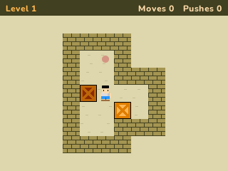
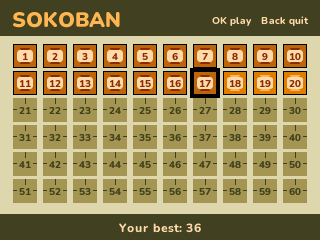

# Sokoban

Push every box onto a goal. Hiroyuki Imabayashi's warehouse puzzle on the NumWorks calculator, with David W. Skinner's Microban: 155 levels, from the very first push to The Dungeon.

- **Microban's 155 levels**, small ones that each show an idea, the easy ones first. **Sokoban.nwa** has all 155; **inside NumPlay** there's room for the first 35. Both keep the same progress, so a level solved in one is solved in the other.
- **The rules of the original:** the keeper pushes the boxes one at a time and can never pull them, so a box pushed into a corner stays there.
- **Undo** takes back your steps one at a time, hundreds of them; **Restart** puts the level back as it began.
- **Moves and pushes** are counted, and the fewest moves you solved each level in are kept.
- **The levels**, ten to a row, each a crate: the ones you solved turn dark like a crate on its goal, the ones still shut are bricks. A level opens while fewer than three before it are still unsolved, so one that blocks you never stops you for good.
- **The levels as Microban has them**, wall for wall, down to the decorations of The Dungeon; big ones shrink to fit the screen.
- **The classic look**: olive brick walls, a sandy floor with pink goal dots, wooden crates with an X that turn dark on their goals, and the warehouse keeper with his black hair, white shirt and blue trousers, the way Sokoban is usually drawn. The pause menu is a sign of planks. The keeper steps a cell at a time, as in the original.

## Controls

| Key | Action |
| --- | --- |
| Arrows, or 8 4 6 2 | Walk, and push a box (hold to keep going) |
| Backspace | Undo a step (hold to undo more) |
| OK or EXE | Choose |
| Back | Pause: Resume, Restart, Levels, How to play, Quit game |

## Credits

**Sokoban** is Hiroyuki Imabayashi's game, first published by Thinking Rabbit in 1982. This version is written in C for NumPlay and drawn from shapes as it goes, with no code or art from any Sokoban.

The levels are **Microban** by **David W. Skinner** (2000), from [his Sokoban page](http://users.bentonrea.com/~sasquatch/sokoban/) as kept on [sneezingtiger.com's Sokoban levels page](http://www.sneezingtiger.com/sokoban/levels.html); they are his, used with credit to him. `levels/microban.txt` holds them as he wrote them. `tools/levels.py` packs them for the game, which puts back the walls around the floor itself (only the others are stored), and `make test` checks every one against Microban as published, then plays through the 153 that `tools/solve.py` solves.

It comes inside [NumPlay](https://github.com/Mason363/NumPlay), or on its own as `Sokoban.nwa` from the [latest release](https://github.com/Mason363/NumPlay/releases/latest).

Build: `make` (needs `arm-none-eabi-gcc`, Node.js for nwlink and Python 3). `make test` checks every level against Microban and plays them through on a computer, then undoes it all.
