> **Sonic the Hedgehog is a [NumPlay](../../README.md) game that comes on its own.** It is too big to sit next to NumPlay. Get `SonicTheHedgehog.nwa` from the [latest release](https://github.com/Mason363/NumPlay/releases/latest).

  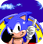

<h1 align="center">Sonic the Hedgehog</h1>

  <b>The 1991 Mega Drive game, whole, on the NumWorks calculator.</b> 
  Green Hill, Marble, Spring Yard, Labyrinth, Star Light and Scrap Brain, the Final Zone, the Special Stages and the six Chaos Emeralds, to the ending, at 60 frames a second.

  <a href="https://github.com/Mason363/NumPlay/releases/latest/download/SonicTheHedgehog.nwa"><b>Download SonicTheHedgehog.nwa</b></a>
  &nbsp;·&nbsp; <a href="#controls">Controls</a>

  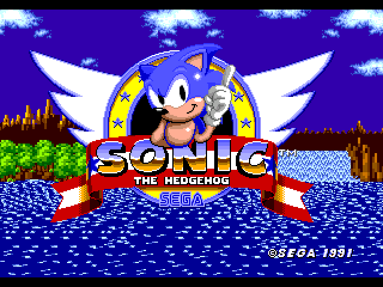

## Highlights

* **All of it:** the six zones, three acts each (Scrap Brain's third under Labyrinth's water), the Final Zone, the six Special Stages, the continue screen, the good and the bad ending, the credits with their demos and Dr. Robotnik juggling the emeralds you missed.
* **The game itself, not a remake:** its code is the original's, routine by routine, in C: Sonic's physics (his speeds, slopes, loops, rolling, the way he sticks to the ground and lets go of it), every object and badnik with its quirks, every boss, the camera, the zones' moving backgrounds, the colour cycles, the water. The attract mode's demos play back the recorded buttons and Sonic goes where he went on the Mega Drive.
* **Its pictures and levels:** the art, the levels, the object placement, the palettes and the demos come from the game's data (see Credits), drawn as the Mega Drive drew them: two scrolling planes and the sprites, a scroll for each line, the water's palette below its surface.
* **The Special Stages:** the maze turning round Sonic, with its bumpers, UP and DOWN, R, glass and ghost blocks and the emerald in the middle, and the birds turning into fish behind it.
* **Saved:** each act as it starts, and Home or On/Off keeps where you are: Continue on the title goes back to it with your lives, continues, emeralds and score. The save is also copied into `sonic_saves.py`, so installing the app again doesn't erase it.

<table>
  <tr>
    <td align="center">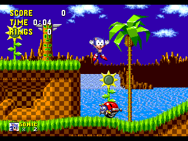 Green Hill Zone</td>
    <td align="center">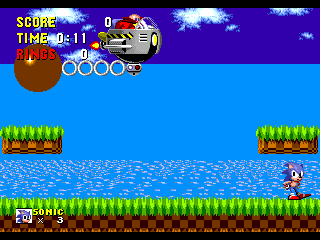 Dr. Robotnik's wrecking ball</td>
  </tr>
  <tr>
    <td align="center">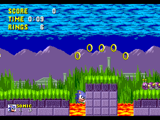 Marble Zone</td>
    <td align="center">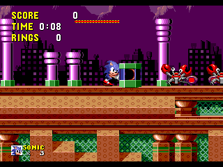 Spring Yard Zone</td>
  </tr>
  <tr>
    <td align="center">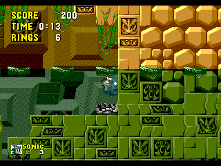 Labyrinth Zone, under water</td>
    <td align="center">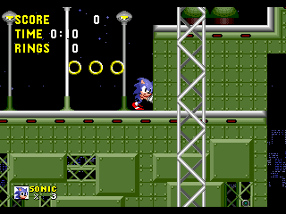 Star Light Zone</td>
  </tr>
  <tr>
    <td align="center">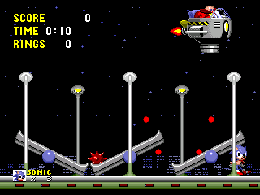 Spiked balls and seesaws</td>
    <td align="center">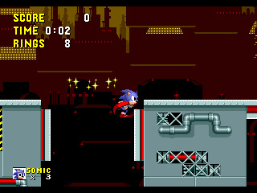 Scrap Brain Zone</td>
  </tr>
  <tr>
    <td align="center">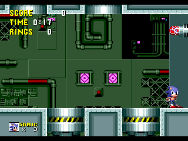 The Final Zone's crushing cylinders</td>
    <td align="center">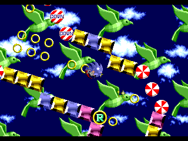 A Special Stage</td>
  </tr>
  <tr>
    <td align="center">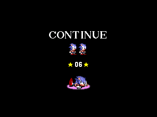 Continue?</td>
    <td align="center">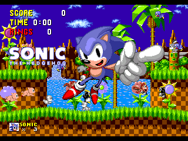 The ending</td>
  </tr>
</table>

## How to play

Run to the right and reach the signpost at the end of each act; the third act of each zone ends with Dr. Robotnik and the capsule his animals are locked in. Collect rings: when something hits you, you only drop them, and with none you lose a life. A hundred rings give an extra life. Roll into badniks or jump on them to free the animals inside.

Finish an act with 50 rings or more and a giant ring appears by the signpost: jump into it for a Special Stage. Steer Sonic through the turning maze to the Chaos Emerald in the middle, away from the GOAL blocks. The six emeralds change the ending.

When the game is over, the continues you collected (50 rings in a Special Stage) let you go on from the act you were in.

## Controls

| Key | What it does |
| --- | --- |
| Arrows (or 4, 6, 8, 2) | Run, look up, duck; Down while running rolls |
| OK, EXE, 5, 0 or Shift | Jump (A, B and C on the Mega Drive pad) |
| Back or ⌫ | Start: pause, with Resume and Quit game |
| Home or On/Off | Save and quit: Continue on the title goes back there |

## Good to know

* **One app at a time:** Sonic the Hedgehog is too big to sit next to NumPlay or the other big games. Installing it from the NumWorks website swaps them out, and installing them again swaps it out. Your saves in each one are kept.
* **The picture:** the Mega Drive's 320 by 224 picture, one pixel for one, with a band above and below. On the N0110 the slowest moments leave a frame out now and then to keep the game at full speed.
* **No music or sound:** the calculator has no speaker.
* **Not in it:** the cheats (level select, debug mode), so no object placing.

## Credits

Inspired by Sonic the Hedgehog (1991) by Sonic Team, not affiliated with SEGA.

* The game's art, levels, object placement, palettes and demos are read from the [Sonic Retro disassembly](https://github.com/sonicretro/s1disasm) (`tools/fetch.py` gets it, `tools/pack.py` packs it), whose labels and notes the code follows.
* The physics follow the [Sonic Physics Guide](https://info.sonicretro.org/Sonic_Physics_Guide).

Made by Mason Chen as part of NumPlay.

## License

The game's code is licensed under the GNU General Public License v3.0: see the `LICENSE` file at the root of the repository. Sonic the Hedgehog's pictures, levels and characters belong to SEGA (see Credits).
