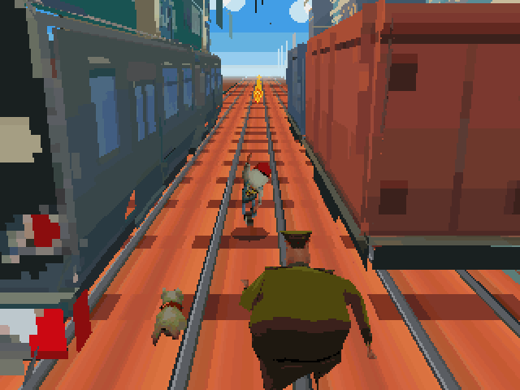
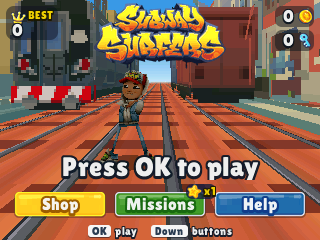
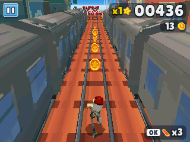
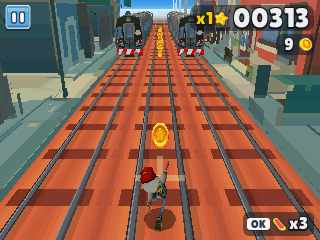
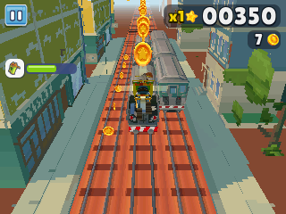
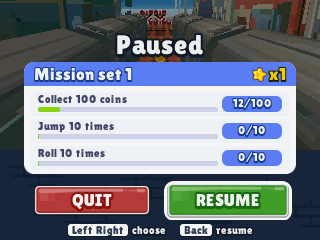
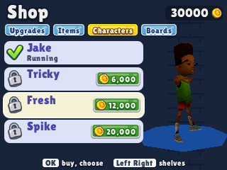

> **Subway Surfers is a [NumPlay](../../README.md) game that comes on its own.** It is too big to sit next to NumPlay. Get `SubwaySurfers.nwa` from the [latest release](https://github.com/Mason363/NumPlay/releases/latest).

  

<h1 align="center">Subway Surfers</h1>

  <b>Dash down the subway's tracks, dodge the trains and outrun the Inspector, on the NumWorks calculator.</b> 
  The endless run in 3D, seen from behind and above like on phones, with its coins, power-ups, hoverboards, missions and shop.

  <a href="https://github.com/Mason363/NumPlay/releases/latest/download/SubwaySurfers.nwa"><b>Download SubwaySurfers.nwa</b></a>
  &nbsp;·&nbsp; <a href="#controls">Controls</a>

  

## Highlights

* **The game's own people:** Jake, Tricky, Fresh and Spike, the Inspector and his dog are the game's own 3D models and textures, with fewer triangles for the calculator. They move with the game's own animations: running, jumping, rolling, dodging, surfing, flying with the jetpack, stumbling, being caught. From behind, Jake has his white hood and the Sub Surf graffiti on his vest, as in the game.
* **Subway City:** the game's own streets and yards along the tracks, its elevated line and stations, its glass hall, its trains (the silver subway train, the teal train, the red cargo wagons and their engine, the ramp wagon), its barriers and its tracks. They are the game's models, made into a few flat faces each with all their detail painted on, so the calculator can draw them fast.
* **The game's numbers:** the speed (from 110 to 220 of the game's units a second over three minutes), a lane change in 0.27 seconds, jumps 20 units high, rolls of 0.6 seconds, the camera 33 units up and 33 behind, the time of each power-up at each upgrade (jetpack 8 to 25 seconds, the others 10 to 30), a 30 second hoverboard, a 6 second headstart, the score multiplier up to x30.
* **Trains and barriers:** trains standing on the tracks and trains coming at you with their lights on, ramp wagons up onto the roofs, the low barrier to jump, the tall one to roll under, and the one on trestles to jump or roll under. Hit the side of a train or a barrier and you stumble: the Inspector and his dog are right behind you, and if you stumble again you're caught. Run into anything head-on and it's over.
* **Coins and power-ups:** the game's coins in lines and arcs, the **Jetpack**, **Super Sneakers**, **Coin Magnet** and **2x Multiplier**, **Mystery boxes** and **keys**, all the game's own models, turning.
* **Hoverboards:** OK rides one for 30 seconds, and a crash only breaks the board. The game's three boards: the classic **Hoverboard**, the **Bouncer** (super jumps) and the **Daredevil** (faster).
* **Headstarts and score boosters:** at the start of a run, 1 flies you far ahead and 3 adds 5 to your score multiplier.
* **Save me!** Crashed? Spend a key to keep going: then 2, 4, 8...
* **Missions:** sets of three, like "Jump 25 times in one run". Finish a set and your score multiplier goes up, all the way to x30.
* **The game's screens:** its score plate with the star, its pause button, its pause screen with the missions and QUIT and RESUME, its popups, buttons, icons and logo, in its own lettering. Every screen shows which keys to press.
* **The shop:** upgrade each power-up (six steps), buy hoverboards, headstarts, score boosters and mystery boxes, and unlock **Tricky**, **Fresh** and **Spike** and the boards.
* **Smooth:** about 30 frames a second or more on every calculator.
* **Saved:** your coins, keys, best score, items, upgrades, characters, boards and missions. Home or On/Off saves and quits from anywhere, and keeps the coins of a run. The save is also copied into `subway_saves.py`, so installing the app again doesn't erase it.

<table>
  <tr>
    <td align="center" width="50%"></td>
    <td align="center" width="50%"></td>
  </tr>
  <tr>
    <td align="center"></td>
    <td align="center"></td>
  </tr>
  <tr>
    <td align="center"></td>
    <td align="center"></td>
  </tr>
</table>

## Controls

| Key | Action |
| --- | --- |
| Left, Right, or 4 6 | Change tracks |
| Up or 8 | Jump |
| Down or 2 | Roll; in the air, dive down and roll |
| OK, EXE or 5 | Ride a hoverboard; choose, buy |
| 1 | A headstart (at the start of a run) |
| 3 | A score booster (at the start of a run) |
| Back or ⌫ | Pause (QUIT or RESUME, QUIT asks first); back in the menus |
| Home or On/Off | Save and quit |

On the title, OK plays, and Down goes to the **Shop**, the **Missions** and **Help**. In the shop, Left and Right go from shelf to shelf.

## Good to know

* **One app at a time:** Subway Surfers is too big to sit next to NumPlay or the other big games. Installing it from the NumWorks website swaps them out, and installing them again swaps it out. Your saves in each one are kept.
* **No clock, no daily rewards:** the calculator has no clock, so there are no daily challenges or word hunts.
* **No music or sound:** the calculator has no speaker.
* **Where the pictures come from:** everything you see is the game's own: its 3D models, textures, animations, screen pictures and logo, taken from its Android package (version 3.70.3) with `tools/apk.py`. The city is the game's Subway City yard, in the colours of its Plant Invasion version, without the plants.

## Credits

Subway Surfers is a game by SYBO (first with Kiloo). This port is not affiliated with or endorsed by them.

* The people, the Inspector and his dog, their animations, the trains, barriers, tracks and city, the coins, keys, power-ups and boards, the icons, buttons and logo, and the app icon are the game's own (SYBO's), taken from its Android package.
* The lettering is the game's own font, **Lilita One** by Juan Montoreano, under the SIL Open Font License ([license](../../LICENSES/OFL-1.1-LilitaOne.txt)).

Made by Mason Chen as part of NumPlay.

Build: `make` (needs `arm-none-eabi-gcc` and Node.js for nwlink); `make test` plays it on a computer. `make data APK=DIR` makes `src/data.c` and `src/icon.png` again from the game's Android package unzipped in `DIR` (`tools/apk.py` reads its bundles with UnityPy, `tools/decimate.py` takes triangles away, `tools/bake.py` makes the city's faces); the result is committed, so building needs neither the package nor the network.

## License

The port's code is licensed under the GNU General Public License v3.0: see the `LICENSE` file at the root of the repository. The game's pictures, models and animations are SYBO's, and the font keeps its own terms (see Credits).
