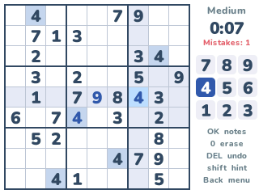
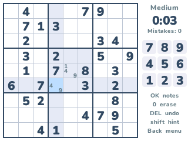

# Sudoku

Fill the grid so every row, column and 3×3 box holds the digits 1 to 9 once. Sudoku on the NumWorks calculator, played like the phone apps: a clean grid, the cell's row, column and box lit up, notes, undo and hints, and the calculator's own number keys to write with.

- **Endless puzzles at four levels**, each made on the calculator in a fraction of a second, with one solution and the clues set symmetrically:
  - **Easy** and **Medium** can be solved with singles alone (a cell with one digit left, or a digit with one place left in a row, column or box), Medium with fewer clues;
  - **Hard** needs pointing: a digit that, in a box, can only go in one of its rows or columns, so it goes nowhere else in that row or column (or the other way round);
  - **Expert** needs more than that.
- **The usual highlights:** the row, column and box of the cell picked, and every cell with the same digit. Wrong digits turn red and count as mistakes.
- **Notes:** OK switches to pencil marks, small digits in the corners of a cell. Writing a digit takes its note off every cell it sees.
- **Undo** every move (notes included), **erase**, and **hints** that fill the cell picked, or the next one that isn't right yet.
- The digits on the right are laid out as on the keypad; the ones placed nine times fade.
- A clock, a mistake counter and the **best time** of each level. The game in progress is kept when you leave.

## Controls

| Key | Action |
| --- | --- |
| Arrows | Pick a cell (around the edges too) |
| 1 to 9 | Write that digit, or a note in notes mode |
| OK or EXE | Notes on and off |
| 0 | Erase the cell |
| ⌫ (DEL) | Undo |
| shift | Hint |
| Back | Menu: Resume, New game, How to play, Quit game |

## Credits

Sudoku is the number place puzzle, first published by Dell Magazines in 1979 and named in Japan by Nikoli. This version is written in C for NumPlay; its look and its controls follow the phone apps everyone knows. No puzzle is stored: a solver fills a grid at random and clues are taken out while one solution is left, then graded the way a player would solve them.

Inside NumPlay it draws with the launcher's own shapes and fonts and saves through its file functions, so the game is about 5 KB.

It comes inside [NumPlay](https://github.com/Mason363/NumPlay), or on its own as `Sudoku.nwa` from the [latest release](https://github.com/Mason363/NumPlay/releases/latest).

Build: `make` (needs `arm-none-eabi-gcc` and Node.js for nwlink). `make test` makes puzzles of every level on a computer and checks them.
