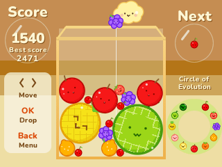

# Suika Game

Drop fruit in the box and join two of a kind into the next one, all the way to the watermelon. Aladdin X's Suika Game for the NumWorks calculator, playing and looking like the Switch game.

- **The 11 fruit**, cherry to watermelon, at the original's sizes and colours, with their faces. Drops come from the first five, each as likely as the others.
- **Two of a kind join** where they touch, into the next fruit of the circle. Two watermelons vanish. Each merge scores as in the original: 1, 3, 6, 10, 15, 21, 28, 36, 45, 55, and 66 for two watermelons.
- **The original's physics.** Fruit fall, roll and stack as on the Switch, measured frame by frame: the same gravity, no bounce, and the next fruit comes the moment the last one touches down.
- **Over the top and it's over.** A fruit that stays above the box for about a second ends the game.
- The cloud, the Next bubble and the circle of evolution, as in the original.
- Your game and best score are saved, so you can stop and carry on later.

## Controls

| Key | Action |
| --- | --- |
| Left and Right, or 4 and 6 | Move the cloud |
| OK or EXE | Drop the fruit |
| Back | Menu: Resume, Restart, How to play, Quit |

## Credits

Suika Game is **Aladdin X**'s game (2021). **Bobydeluxe** brought it to NumPlay. This version is written in C for NumPlay with no code or art from the original. Its fruit sizes, colours, speeds and timings were measured on the Switch version, with the sizes checked against [kairess/suika-game](https://github.com/kairess/suika-game) and players' measurements.

Inside NumPlay it draws with the launcher's own shapes and fonts and saves through its file functions, so the game itself is about 9 KB.

It comes inside [NumPlay](https://github.com/Mason363/NumPlay), or on its own as `SuikaGame.nwa` from the [latest release](https://github.com/Mason363/NumPlay/releases/latest).

Build: `make` (needs `arm-none-eabi-gcc` and Node.js for nwlink). Tests: `make test`.
