> **Undertale is a [NumPlay](../../README.md) game that comes on its own.** It is too big to sit next to NumPlay. Get `Undertale.nwa` from the [latest release](https://github.com/Mason363/NumPlay/releases/latest).

  

<h1 align="center">Undertale</h1>

  <b>Fall into the Underground as a human child, on the NumWorks calculator.</b> 
  The whole Underground, from the bed of golden flowers to the barrier: the Ruins, Snowdin, Waterfall, Hotland, the MTT Resort, the CORE and New Home, to the neutral ending.

  <a href="https://github.com/Mason363/NumPlay/releases/latest/download/Undertale.nwa"><b>Download Undertale.nwa</b></a>
  &nbsp;·&nbsp; <a href="#controls">Controls</a>

  

## Highlights

* **The whole Ruins:** every room, from the golden flowers through Toriel's puzzles, the falling leaves, the spikes, the rocks, the cracked floors and the switches, to Toriel's home and the long corridor under it.
* **Its people, with all they have to say:** Flowey, Toriel and her phone calls, Napstablook, the talking rock, the Froggits who give advice, the spider bake sale, the snail facts, and every sign, bookshelf and mirror.
* **Snowdin:** Sans and Papyrus, and every one of Papyrus's puzzles: the invisible electricity maze, the X and O tiles, the one on ice, the multicolor tiles and the Gauntlet. Then Snowdin Town, with its shop, inn, library and Papyrus's house.
* **Waterfall:** Monster Kid, Grillby's with Sans, the echo flowers, the bridge seeds (and the secret bridge to the quiche), the wishing room, Undyne chasing you with her spears, Sans's telescope, the marsh where the land is black and the water glows, Onionsan, the piano's secret song, the statue in the rain and Monster Kid under your umbrella. Then the fall into the garbage dump, Mad Dummy, Napstablook's house and snail farm, the small bird back over the gap, Gerson's shop, the mushroom maze and Temmie Village with its Tem Shop. And at the end of Waterfall: the lantern maze, Undyne at the dead end (and Monster Kid in her way), the echo flowers' path, Monster Kid on the chasm's bridge, Undyne on her crag, her fight and her chase, and Hotland's edge, where the heat gets her and the water cooler helps.
* **Hotland's first floor:** Alphys's Lab, where Mettaton bursts in with his quiz show, the conveyor belts, the Magma Chamber's steam vents and the burnt pan, the laser walkway, the two shooting puzzles that open the door, the vents over the lava and Mettaton's cooking show, with your phone's jetpack, up to the elevator. Alphys calls you as you go.
* **Hotland's second floor:** Sans's hot dog stand and Heats Flamesman, the invisible path to the Art Club's room, the Stained Apron, the conveyor belt puzzle and its three switches, the vent puzzle, the Bad Opinion Zone, the Royal Guards, and Mettaton's news report, where everything is a bomb and the clock is running.
* **Hotland's third floor:** the spiders' bake sale, the vent islands and their two shooting puzzles (the Diamond Boys, and Alphys asking you to watch anime), the conveyor belts past the laser drones, the spider entrance and Muffet's sticky lair, Mettaton's musical and the trapdoor to his tile puzzle against the clock, and the crossroads with the Nice Cream guy and Heats Flamesman, by the stairs up to the MTT Resort.
* **The MTT Resort:** Sans out front, and dinner with him in the restaurant, where he tells you about the door in the forest; the lobby and its fountain, the MTT-Brand Burger Emporium with Burgerpants behind the counter, Bratty and Catty's shop up the alley, a night in the hotel, room service down the hall (and a dog behind door 4), and the door to the CORE.
* **The CORE:** two black shapes backing away inside, its broken elevator, Madjick's ambush, the switch whose lasers Alphys gets backwards, Knight Knight north of the crossroads, the laser bridge where Alphys cuts the power (and it keeps coming back), and the Core Branch: the sage's path and its shooting puzzle, the warrior's path and its three fights, or a force field that a patient one just waits out. Then The End, Mettaton's last show, Alphys's confession in the last hallway, and the elevator up to the castle.
* **New Home:** the grey city, Asgore's home (two keys for the chained stairs, two presents in the children's room), the story of Asriel and the first human told down its basement's corridors, the Last Corridor where Sans judges you, Asgore among the flowers of his throne room, the coffins below, and the barrier: Asgore, your choice, Flowey and the six SOULs, and the way out.
* **Battles like in the game:** FIGHT with the timing bar, ACT, ITEM and MERCY, and your SOUL dodging each monster's own attacks in the box: Froggit, Whimsun, Moldsmal, Loox, Vegetoid, Migosp, Napstablook and Toriel in the Ruins; Snowdrake, Ice Cap, Gyftrot, Jerry, Chilldrake, Glyde, Doggo, Lesser Dog, Dogamy and Dogaressa, Greater Dog and Papyrus, whose blue attack makes your SOUL fall, in Snowdin; Aaron, Woshua, Moldbygg, Shyren, Temmie, Mad Dummy, who can't be hurt, and Undyne, who turns your SOUL green, in Waterfall; Vulkin, Tsunderplane, Pyrope and the Royal Guards in Hotland, the news report's bombs, defused in the DEFUSE ZONE, Muffet, whose purple SOUL keeps to her strings, and Mettaton, worn down by the yellow SOUL's shots; Final Froggit, Whimsalot, Astigmatism, Madjick and Knight Knight in the CORE, and Mettaton EX, whose show is won on its ratings; Asgore, who breaks MERCY, and Omega Flowey with the six human SOULs in New Home.
* **Spare or fight:** every monster can be spared, and Flowey at the door remembers what you did. Lose to Papyrus and he only locks you in his shed.
* **Saved like in the game:** SAVE at the stars, with the room and the time played. The C menu has your ITEM, STAT and CELL. Home keeps the moment you were at, and your save is also copied into `undertale_saves.py`, so installing the app again doesn't erase it.

<table>
  <tr>
    <td align="center">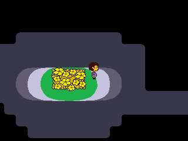 The bed of golden flowers</td>
    <td align="center">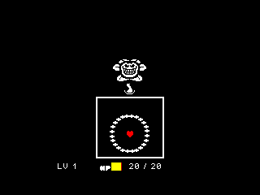 Flowey's friendliness pellets</td>
  </tr>
  <tr>
    <td align="center">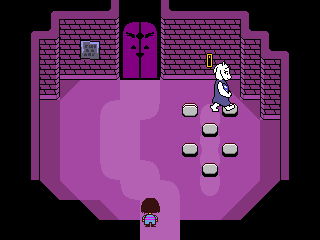 Toriel shows how the puzzles work</td>
    <td align="center"> A Froggit</td>
  </tr>
  <tr>
    <td align="center">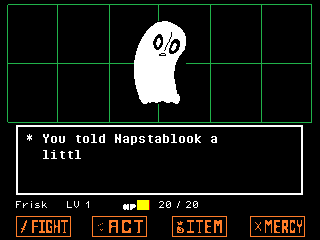 Napstablook</td>
    <td align="center">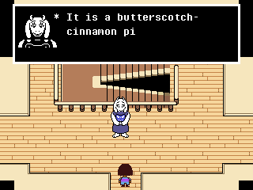 Toriel's home</td>
  </tr>
  <tr>
    <td align="center">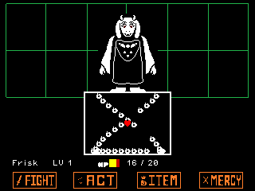 Toriel won't let you leave</td>
    <td align="center">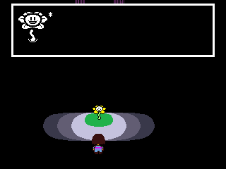 Flowey waits at the door</td>
  </tr>
  <tr>
    <td align="center"> Sans, on the road through Snowdin Forest</td>
    <td align="center">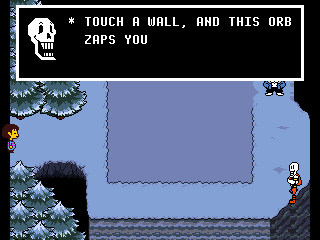 Papyrus's invisible electricity maze</td>
  </tr>
  <tr>
    <td align="center">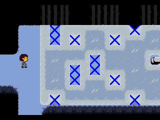 The X and O puzzle on ice</td>
    <td align="center"> Greater Dog</td>
  </tr>
  <tr>
    <td align="center"> Snowdin Town</td>
    <td align="center"> The shop</td>
  </tr>
  <tr>
    <td align="center">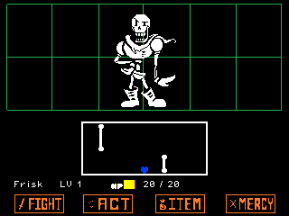 Papyrus's blue attack</td>
    <td align="center"> Hanging out with Papyrus</td>
  </tr>
  <tr>
    <td align="center">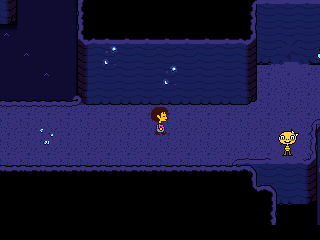 Monster Kid, by the first echo flower</td>
    <td align="center"> Bridge seeds bloom in the water</td>
  </tr>
  <tr>
    <td align="center">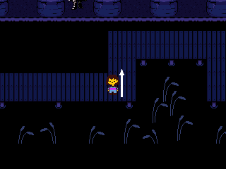 Undyne's spears on the boardwalk</td>
    <td align="center">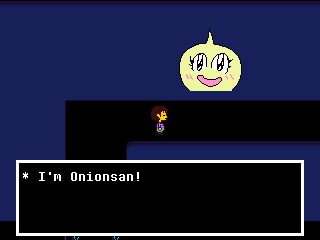 Onionsan says hi</td>
  </tr>
  <tr>
    <td align="center"> The statue in the rain</td>
    <td align="center"> Monster Kid and the castle, far away</td>
  </tr>
  <tr>
    <td align="center">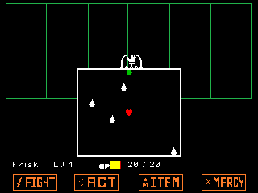 Woshua's green drop heals</td>
    <td align="center">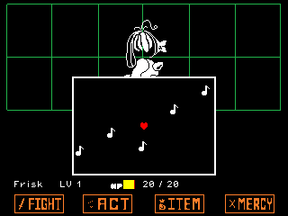 Shyren sings when you hum along</td>
  </tr>
  <tr>
    <td align="center"> Mad Dummy sends its dummies</td>
    <td align="center"> At Napstablook's house</td>
  </tr>
  <tr>
    <td align="center"> Gerson's shop</td>
    <td align="center"> Temmie Village</td>
  </tr>
  <tr>
    <td align="center">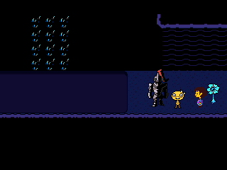 Monster Kid gets in Undyne's way</td>
    <td align="center"> Monster Kid hangs off the bridge</td>
  </tr>
  <tr>
    <td align="center"> Undyne on her crag</td>
    <td align="center">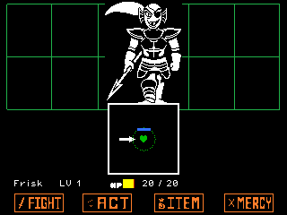 Block Undyne's spears with the green SOUL</td>
  </tr>
  <tr>
    <td align="center">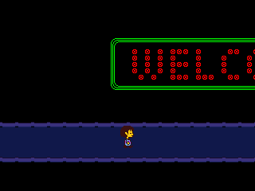 Welcome to Hotland</td>
    <td align="center"> Water for Undyne, in Hotland's heat</td>
  </tr>
  <tr>
    <td align="center"> Alphys, in her Lab</td>
    <td align="center"> Mettaton's quiz show</td>
  </tr>
  <tr>
    <td align="center"> Orange lasers: keep moving</td>
    <td align="center"> A shooting puzzle</td>
  </tr>
  <tr>
    <td align="center"> Cooking with a killer robot</td>
    <td align="center">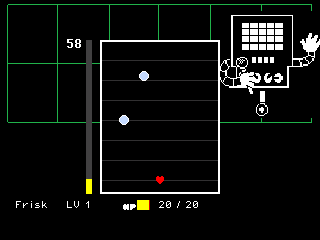 Up the counter with the jetpack</td>
  </tr>
  <tr>
    <td align="center"> A hot dog from Sans</td>
    <td align="center">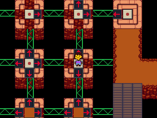 The vent puzzle</td>
  </tr>
  <tr>
    <td align="center"> The Royal Guards got a tip</td>
    <td align="center"> Their team attack</td>
  </tr>
  <tr>
    <td align="center"> MTT News: two minutes to go</td>
    <td align="center">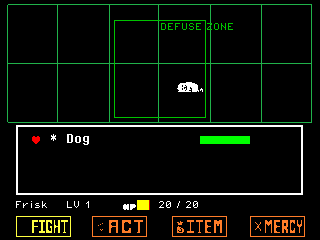 Defuse it in the DEFUSE ZONE</td>
  </tr>
  <tr>
    <td align="center">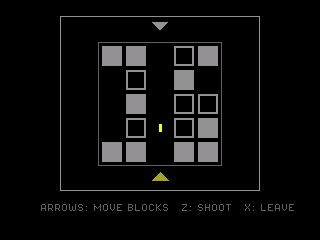 One shot to clear the way</td>
    <td align="center">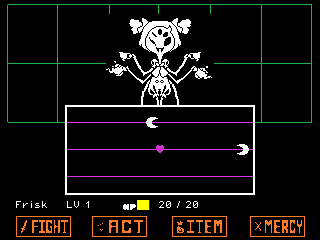 Muffet's strings, the purple SOUL</td>
  </tr>
  <tr>
    <td align="center">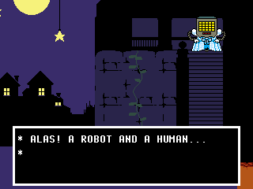 Mettaton's musical</td>
    <td align="center">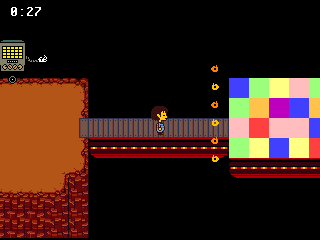 The tile puzzle, against the clock</td>
  </tr>
  <tr>
    <td align="center">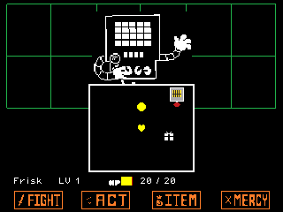 The yellow button</td>
    <td align="center">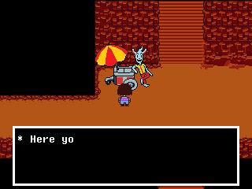 Nice Cream, by the MTT Resort</td>
  </tr>
  <tr>
    <td align="center">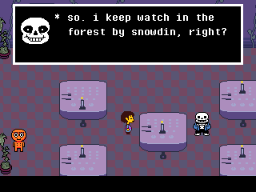 Dinner with Sans at the MTT Resort</td>
    <td align="center">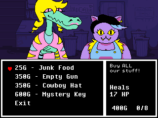 Bratty and Catty's shop, up the alley</td>
  </tr>
  <tr>
    <td align="center">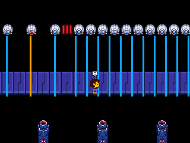 The laser bridge: freeze when the power's on</td>
    <td align="center">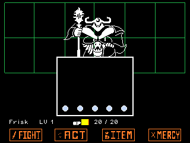 Knight Knight, before her lullaby</td>
  </tr>
  <tr>
    <td align="center">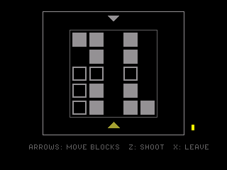 The sage's path, two shots</td>
    <td align="center">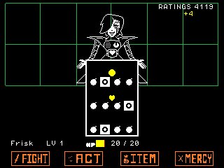 Mettaton EX: keep the ratings up</td>
  </tr>
  <tr>
    <td align="center">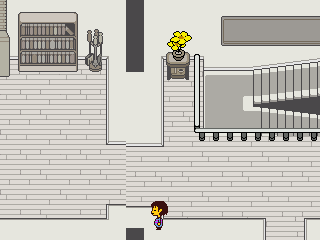 Asgore's home, the stairs chained shut</td>
    <td align="center">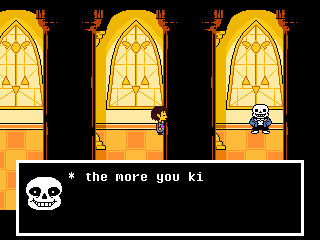 The Last Corridor: Sans's judgment</td>
  </tr>
  <tr>
    <td align="center">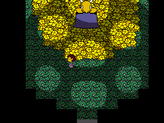 Asgore among his flowers</td>
    <td align="center">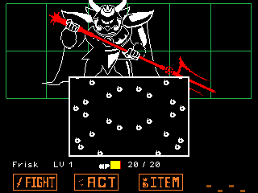 Asgore at the barrier, MERCY broken</td>
  </tr>
  <tr>
    <td align="center">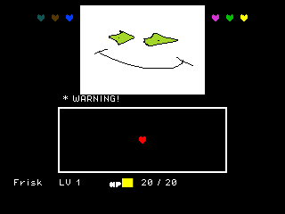 Omega Flowey and the six SOULs</td>
    <td></td>
  </tr>
</table>

## How to play

A new game starts with the story of the war between humans and monsters, then the title. Name the fallen human, and you wake up on the golden flowers. Walk on and talk to whoever you meet: Flowey has a few things to teach you, then Toriel guides you through the Ruins.

Monsters jump out as you walk. In a battle, choose FIGHT to attack (press OK when the bar crosses the middle), ACT to check them, talk or do something else, ITEM to eat, and MERCY to spare them once they no longer want to fight, or to flee. Then move your SOUL, the red heart, to dodge what they throw at you. Each monster has its own way to be spared: try what ACT offers.

Snowdin brings new things: when Papyrus turns your SOUL blue, it falls to the bottom of the box, and Up jumps over his bones. On ice you slide until something stops you. Snowdin Town's shop sells food and gear, and its inn gives you a night's rest.

In Waterfall, walk into a bridge seed to push it: in the water it blooms into a flower you can walk on, and the bell calls the seeds back. A green bullet heals you instead of hurting. Talk to the piano to play it, and keep an umbrella for the rain. The Tem Shop is the one shop that buys what you carry. When Undyne turns your SOUL green, it can't move: turn its shield with the arrows to block her spears. She can't be spared: run, and she'll chase you.

In Hotland, conveyor belts carry you and steam vents throw you over the lava (the one in the middle of the puzzle hub turns each time). Keep moving through orange lasers and stand still for blue ones. In a shooting puzzle, the arrows push every dark block one cell and Z shoots: break your way to the target in two shots. In Mettaton's quiz, move your SOUL onto an answer and press OK; Alphys signals the right one. Alphys's upgrade puts the Dimensional Box in your phone's CELL. On the second floor, the top conveyor belt carries you past three switches: press them one after another as you go by. In the vent puzzle, every panel you land on turns all the vents around, and the one at the top turns them back. To spare the Royal Guards, clean 02's armor, catch its green stars, then whisper to 01. In the news report, touch a bomb to face it, and Defuse it (or FIGHT it) while it's in the DEFUSE ZONE. On the third floor, ride the belt past the blue drones without a step. When Muffet turns your SOUL purple, it keeps to three strings: Up and Down hop between them, Left and Right move along. In the tile puzzle, red tiles are walls, yellow ones shock you back, orange ones make you smell of oranges (and the blue water's piranhas bite then), purple soap slides you on and makes you smell of lemons, and blue next to yellow is electrified. After it, ACT and press the yellow button: your SOUL turns yellow, and OK shoots. At the MTT Resort, the front desk rents you a room for the night, and the hotel's doors down the hall want room service: bring what they ask for. On the CORE's laser bridge, walk while the power is off and freeze the moment it flickers back on. Against Mettaton, turn him round first; then it's a show: Boast, Pose, a Heel Turn, his brand's food and every hit you take make the ratings climb, and once they're high enough the show is over. In New Home, find both keys to unchain the stairs down. Asgore breaks MERCY: you'll have to fight him, and then choose. Against Omega Flowey there are no turns: dodge, and when a SOUL fights for him, reach the ACT button that comes down among its attack to call for help. Once all six are on your side, reach FIGHT.

Walk up to a star and press OK to SAVE and fill your HP. The C menu (toolbox) shows your items, your STAT and the phone numbers you have. Its SETUP, like Settings on the title, lets Frisk walk twice as fast: the game has no such thing, so it starts off.

## Controls

| Key | What it does |
| --- | --- |
| Arrows (or 4, 6, 8, 2) | Walk, move your SOUL, choose |
| OK, EXE or 5 | Talk, read, confirm (Z in the game) |
| Back or ⌫ | Cancel, show the whole text at once (X in the game) |
| Toolbox, Shift or Var | The menu: ITEM, STAT, CELL (C in the game), SETUP |
| Home | Keep the moment and quit: the next start is back there |

## Good to know

* **One app at a time:** Undertale is too big to sit next to NumPlay or the other big games. Installing it from the NumWorks website swaps them out, and installing them again swaps it out. Your saves in each one are kept.
* **The neutral ending:** the game plays from the start to the barrier and the neutral ending, with Sans's call after. The true pacifist ending (the True Lab, Asriel) and the genocide route aren't in it.
* **No music or sound:** the calculator has no speaker.
* **The same Underground:** the rooms and pictures are the game's, everyone says what they say in the game, in shorter words of our own, and the puzzles and battles follow how the game plays them, at its 30 frames a second.

## Credits

Inspired by Undertale by Toby Fox, not affiliated with him.

* The maps and pictures come from the [Undertale Wiki](https://undertale.fandom.com) and the game's free demo, and what's said follows them.
* The **Pixel Operator** fonts are by Jayvee Enaguas, released into the public domain (CC0).
* The LZMA decoder in `src/lzma` is by Igor Pavlov, in the public domain.

Made by Mason Chen as part of NumPlay.

## License

The game's code is licensed under the GNU General Public License v3.0: see the `LICENSE` file at the root of the repository. The game's pictures, maps and texts keep their own terms (see Credits).
