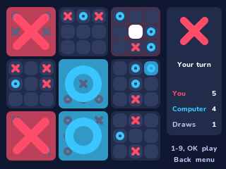

# Ultimate Tic-Tac-Toe

Tic-tac-toe made of tic-tac-toe: nine small boards in a big one, on the NumWorks calculator. Play a friend on the same calculator, or the computer.

- **The real rules.** The cell you take sends the other player to the small board in the same place: take the top right cell of a board, and they must play in the top right board. Win a small board with three in a row; once a board is won or full, nobody plays there again, and a player sent there may play anywhere. Win three small boards in a row to win the game; when every board is over without that, it's a draw.
- **A friend or the computer.** Two players take turns on one calculator, or one player meets the computer, easy, normal or hard. The hard one looks many moves ahead, as deep as it can in a second, and it is tough to beat. Against the computer, X and O swap every game, and X always starts.
- **Clear to read.** The small boards you may play in light up in your colour, won boards show their big X or O, the last move is marked, and a line runs through the winning boards.
- **Saved as you play.** The game in progress comes back the next time, and the games each side has won, and the draws, are kept for every opponent.

## Controls

| Key | Action |
| --- | --- |
| 1 to 9 | Take that cell of the small board you must play in: the number pad is a small board, 7 at the top left. On a free move, the first number picks the board |
| Arrows, then OK or EXE | Move over the cells, then take one |
| Back | Menu: Resume, New game (Left and Right choose the opponent), Quit game |
| Home | Quit |

## Credits

Ultimate tic-tac-toe is a folk game, played on paper long before calculators; it became widely known through [Ben Orlin's 2013 article](https://mathwithbaddrawings.com/2013/06/16/ultimate-tic-tac-toe/). This version is written in C for NumPlay.

Inside NumPlay it draws with the launcher's own shapes and fonts and saves through its file functions, so the game itself, the computer included, is under 5 KB.

It comes inside [NumPlay](https://github.com/Mason363/NumPlay), or on its own as `UltimateTicTacToe.nwa` from the [latest release](https://github.com/Mason363/NumPlay/releases/latest).

Build: `make` (needs `arm-none-eabi-gcc` and Node.js for nwlink). `make test` checks the rules and the computer on a computer.
